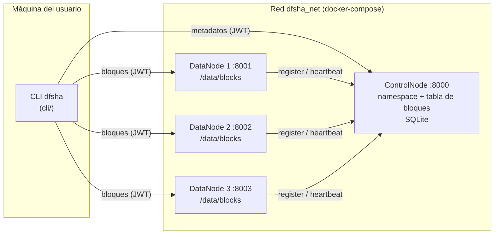
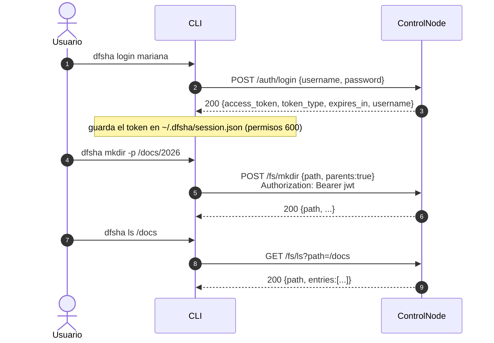
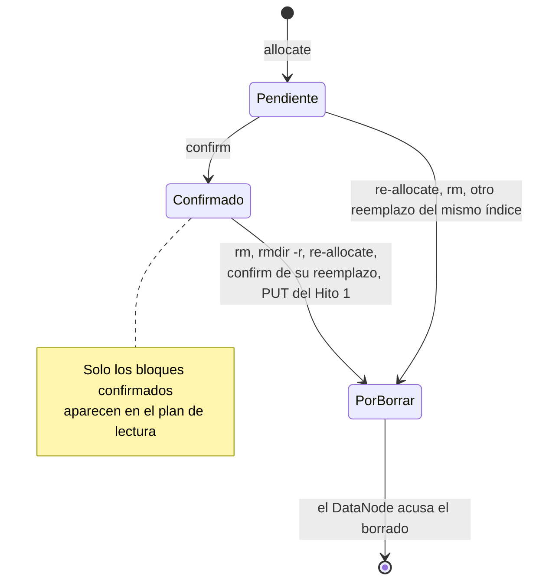
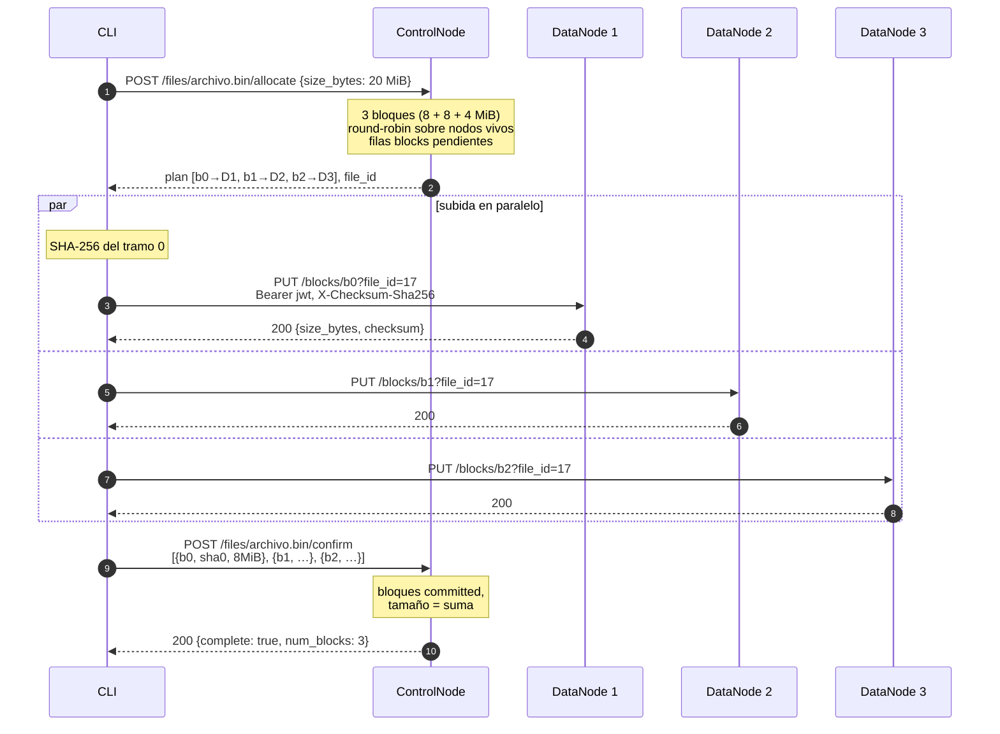
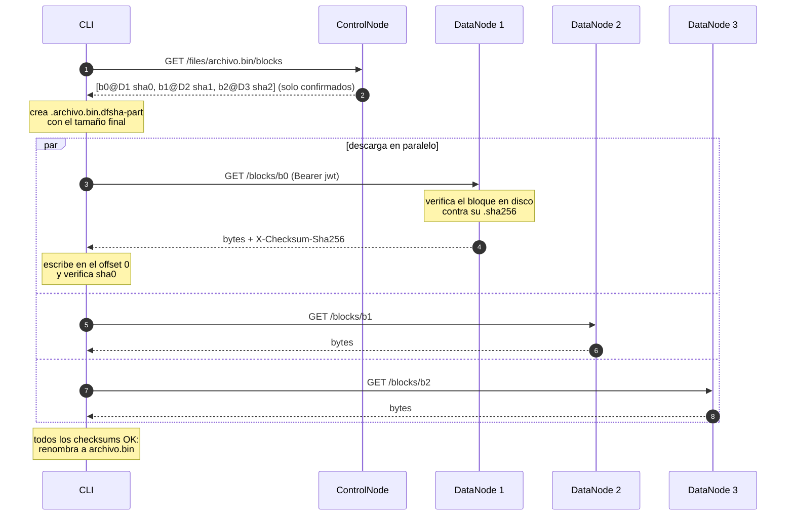
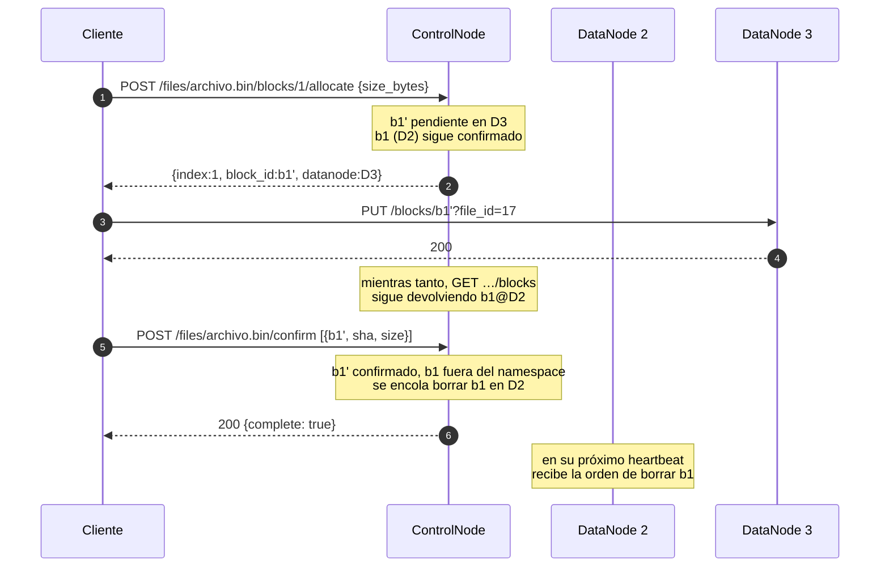
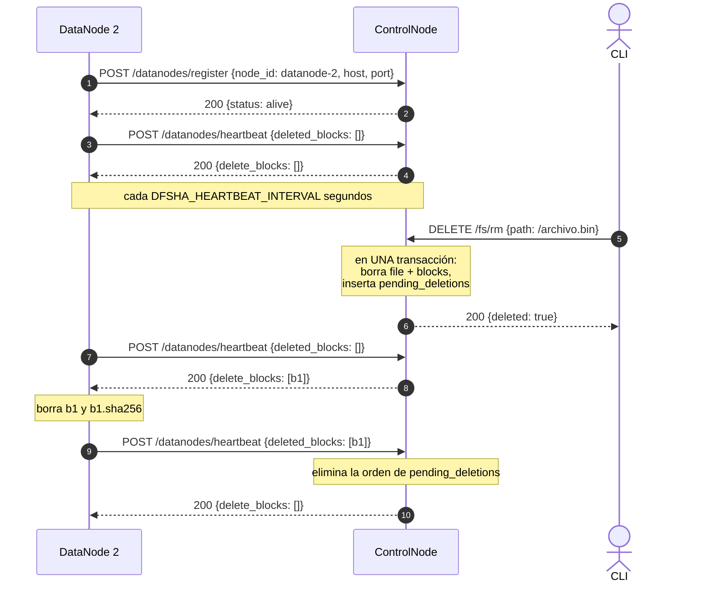
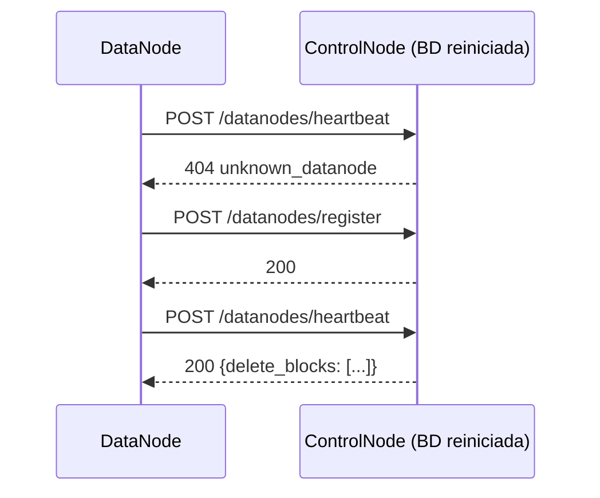
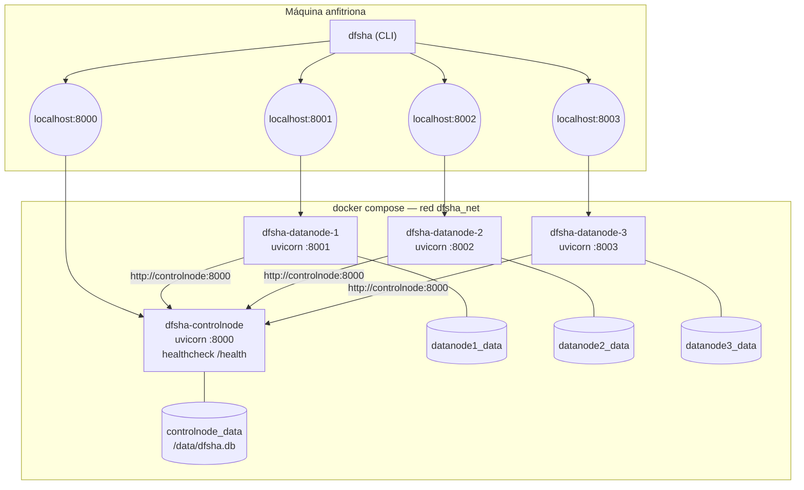

# DFSha — Especificación de protocolos y APIs (Hito 2)

Sistema de archivos distribuido por bloques, al estilo de HDFS. Este
documento especifica cómo se comunican sus componentes, con un diagrama
para cada uno de los cuatro flujos del hito:

1. [Cliente ↔ ControlNode](#3-flujo-1--cliente--controlnode)
2. [Cliente ↔ DataNode](#4-flujo-2--cliente--datanode)
3. [ControlNode ↔ DataNode (registro, heartbeat y borrado)](#5-flujo-3--controlnode--datanode)
4. [docker-compose en ejecución](#6-flujo-4--despliegue-con-docker-compose)

La referencia campo a campo de cada endpoint está en
[`CONTRATOS.md`](../CONTRATOS.md); los modelos Pydantic, en
`app/schemas.py`.

---

## 1. Arquitectura



| Componente | Código | Responsabilidad | Estado |
|---|---|---|---|
| **ControlNode** | `app/` | Namespace (directorios y archivos), usuarios y login, tabla de bloques, liveness de DataNodes, reparto de bloques (round-robin sobre nodos vivos), cola de borrados. **Nunca recibe ni envía contenido de archivos distribuidos.** | SQLite (`/data/dfsha.db`) |
| **DataNode** | `datanode/` | Guarda y sirve bloques sueltos (`<storage>/<file_id>/<block_id>`) con su checksum. Nunca tiene el archivo completo. Valida el JWT del cliente. | Disco local (`/data/blocks`) |
| **Cliente** | `cli/` | Parte el archivo en bloques, los sube y descarga en paralelo directamente con los DataNodes, verifica checksums y reensambla. El usuario solo escribe `dfsha put archivo.txt`: no sabe en qué nodos caen los bloques (transparencia de localización). | Sesión en `~/.dfsha/session.json` |

Principios:

- **Separación de metadatos y datos.** Los bytes van del cliente al
  DataNode sin pasar por el ControlNode, así que el ControlNode no es un
  cuello de botella para la transferencia.
- **Escritura en dos fases.** Un archivo solo es legible cuando sus
  bloques están *confirmados* (`committed`). Un bloque planificado pero no
  confirmado nunca aparece en el plan de lectura.
- **El ControlNode no llama a los DataNodes.** Toda la comunicación
  ControlNode↔DataNode la inicia el DataNode (registro y heartbeat); las
  órdenes de borrado viajan en la respuesta del heartbeat, como en HDFS.
- **Integridad de extremo a extremo.** El cliente calcula el SHA-256 de
  cada bloque. El DataNode lo verifica al recibir, lo guarda y lo vuelve a
  verificar antes de servir. El cliente lo verifica de nuevo al descargar.

## 2. Convenciones comunes

**Transporte.** HTTP/1.1 con cuerpos JSON (UTF-8). Los bloques viajan como
`application/octet-stream` crudo, sin multipart, y en streaming por chunks
de 64 KiB en ambos extremos.

**Autenticación.** `POST /auth/login` en el ControlNode emite un JWT
(HS256, 12 h) con `sub` (usuario), `uid`, `iat` y `exp`. Toda petición
posterior, **también a los DataNodes**, lleva
`Authorization: Bearer <jwt>`. El ControlNode y los DataNodes comparten el
secreto `DFSHA_JWT_SECRET`, así que el DataNode valida el token localmente,
sin consultar al ControlNode.

| Endpoint | Autenticación |
|---|---|
| `POST /auth/login`, `GET /health` | ninguna |
| ControlNode `/fs/*`, `/files/*` | JWT de usuario |
| ControlNode `/datanodes/*` | ninguna: tráfico interno de la red del clúster; la autenticación nodo-a-nodo es del Hito 3 |
| DataNode `/blocks/*`, `/files/*` | JWT de usuario |

**Errores.** Todo error tiene la forma
`{"detail": {"error": "<código>", "message": "<texto legible>"}}`.

| HTTP | `error` | Dónde |
|---|---|---|
| 400 | `invalid_path`, `root_operation` | ControlNode, rutas |
| 400 | `unknown_block`, `invalid_block_index` | ControlNode, `confirm` y `blocks/{i}/allocate` |
| 400 | `invalid_id`, `checksum_mismatch` | DataNode |
| 401 | `unauthenticated`, `invalid_token`, `invalid_credentials` | ambos |
| 404 | `not_found` | ambos |
| 404 | `unknown_datanode` | ControlNode, heartbeat |
| 409 | `not_a_file`, `not_a_directory`, `already_exists`, `directory_not_empty` | ControlNode |
| 409 | `distributed_file` | ControlNode, `GET /files/{ruta}` del Hito 1 sobre un archivo en bloques |
| 422 | `validation_error` | ControlNode, cuerpo malformado |
| 500 | `corrupt_block` | DataNode, el bloque en disco no coincide con su checksum |
| 503 | `no_datanodes` | ControlNode, no hay DataNodes vivos para asignar |

**Identificadores.**

- `file_id`: entero asignado por el ControlNode.
- `block_id`: 32 caracteres hexadecimales opacos (UUID4), únicos en todo el
  clúster.
- El DataNode solo acepta ids con el formato `[A-Za-z0-9_-]{1,128}`, lo
  que impide ataques de *path traversal*.

**Particionamiento.** `n = ceil(tamaño / block_size)` bloques; todos miden
`block_size` salvo el último, que lleva el resto. `block_size` lo elige el
cliente por archivo o, si no lo indica, se usa `DFSHA_BLOCK_SIZE_BYTES`
(8 MiB por defecto). El bloque *i* va al nodo
`vivos[(inicio + i) mod k]`, donde `vivos` son los *k* DataNodes vivos
ordenados por id. `inicio` avanza en cada `allocate` para balancear la
carga entre archivos.

---

## 3. Flujo 1 — Cliente ↔ ControlNode

El cliente habla con el ControlNode para autenticarse, gestionar el
namespace (RF1) y obtener los planes de escritura y lectura de bloques.

### 3.1 Login y namespace



| Método y ruta | Cuerpo / parámetros | Respuesta |
|---|---|---|
| `POST /auth/login` | `{username, password}` | `{access_token, token_type, expires_in, username}` |
| `GET /fs/ls` | `?path=` | `{path, entries[]}` |
| `GET /fs/stat` | `?path=` | `{type, path, name, size_bytes, owner, …}` |
| `POST /fs/mkdir` | `{path, parents}` | `{path, …}` |
| `DELETE /fs/rmdir` | `{path, recursive}` | `{path, deleted}` |
| `DELETE /fs/rm` | `{path}` | `{path, deleted}` |
| `GET /datanodes` | — | `[{node_id, host, port, status, last_heartbeat, registered_at}]` |

### 3.2 Plan de escritura y de lectura

| Método y ruta | Cuerpo | Respuesta |
|---|---|---|
| `POST /files/{ruta}/allocate` | `{size_bytes, block_size?}` | `{path, file_id, block_size, total_size, blocks:[{index, block_id, file_id, size_bytes, datanode:{node_id, host, port}}]}` |
| `POST /files/{ruta}/blocks/{i}/allocate` | `{size_bytes}` | un `{index, block_id, file_id, size_bytes, datanode}` |
| `POST /files/{ruta}/confirm` | `{blocks:[{block_id, checksum, size_bytes}]}` | `{path, file_id, size_bytes, num_blocks, complete}` |
| `GET /files/{ruta}/blocks` | — | `{path, file_id, size_bytes, num_blocks, blocks:[{index, block_id, file_id, size_bytes, checksum, datanode}]}` |

Estados de un bloque en el ControlNode:



Reglas:

- `allocate` sobre un archivo existente descarta su plan anterior (mismo
  `file_id`, nuevos `block_id`).
- Reemplazar un bloque (`blocks/{i}/allocate` con `i` menor que el número
  de bloques) crea una fila pendiente, pero **la versión confirmada se
  sigue sirviendo** hasta que se confirme la nueva. Así, un lector
  concurrente nunca ve un hueco.
- `blocks/{i}/allocate` con `i` igual al número de bloques anexa un bloque
  al final; un `i` mayor es `400 invalid_block_index`.
- `confirm` puede confirmar un subconjunto de bloques. `complete` es
  `true` cuando no queda ningún bloque pendiente.

---

## 4. Flujo 2 — Cliente ↔ DataNode

El cliente sube y baja los bloques **directamente** a los DataNodes que
indica el plan, en paralelo (4 a la vez por defecto,
`DFSHA_PARALLEL_TRANSFERS`).

### 4.1 API del DataNode

| Método y ruta | Entrada | Salida |
|---|---|---|
| `PUT /blocks/{block_id}?file_id={file_id}` | cuerpo crudo; headers `Authorization`, `X-Checksum-Sha256` (opcional pero la CLI siempre lo manda), `Content-Length` | `200 {block_id, file_id, size_bytes, checksum}`; `400 checksum_mismatch`; `400 invalid_id` |
| `GET /blocks/{block_id}` | `Authorization` | `200` cuerpo crudo con `Content-Length` y `X-Checksum-Sha256`; `404 not_found`; `500 corrupt_block` |
| `DELETE /blocks/{block_id}` | `Authorization` | `200 {block_id, deleted}`; `404` |
| `DELETE /files/{file_id}/blocks` | `Authorization` | `200 {file_id, blocks_deleted}` |
| `GET /health` | — | `200 {status, node_id}` |

Almacenamiento: cada archivo es un directorio y cada bloque un archivo
dentro de él:

```
/data/blocks/
└── 17/                                   <- file_id
    ├── 9f2c…e1                           <- block_id (contenido)
    └── 9f2c…e1.sha256                    <- su checksum
```

La escritura va a un temporal único (`<block_id>.<uuid>.tmp`) y se renombra
de forma atómica solo si el checksum coincide. Un fallo a mitad de la
escritura nunca deja un bloque corrupto ni pisa la versión anterior.

### 4.2 `dfsha put archivo.bin` (escritura completa)



Si un DataNode rechaza un bloque (checksum, caída, red), la CLI aborta
**sin confirmar**: el archivo no queda visible con contenido parcial, y
repetir el `put` crea un plan nuevo y ordena borrar el anterior.

### 4.3 `dfsha get archivo.bin` (lectura)



Si un bloque falla (404, checksum distinto o tamaño distinto), se borra el
temporal y **el archivo local previo, si existía, queda intacto**.

Compatibilidad con el Hito 1: si el plan no tiene bloques pero `stat` dice
que el archivo tiene contenido, el archivo se subió con el `PUT`
monolítico. En ese caso la CLI lo descarga con `GET /files/{ruta}` del
ControlNode.

### 4.4 Reemplazo de un bloque (acceso CRUD)



---

## 5. Flujo 3 — ControlNode ↔ DataNode

La comunicación la inicia siempre el DataNode. Esto permite que un
DataNode arranque antes que el ControlNode y que el ControlNode no necesite
alcanzarlo por red (en docker-compose, el host que se anuncia a los
clientes es `localhost`, que no sirve dentro de la red de Docker).

### 5.1 API

| Método y ruta | Cuerpo | Respuesta |
|---|---|---|
| `POST /datanodes/register` | `{node_id, host, port}` | `{node_id, host, port, status, last_heartbeat, registered_at}` |
| `POST /datanodes/heartbeat` | `{node_id, deleted_blocks: [block_id]}` | `{node_id, status, last_heartbeat, delete_blocks: [block_id]}`; `404 unknown_datanode` |
| `GET /datanodes` | — | lista con `status` calculado (`alive`/`dead`) |

- **Liveness.** Un nodo está vivo si su último heartbeat tiene menos de
  `DFSHA_HEARTBEAT_TTL_SECONDS` (30 s por defecto). Los DataNodes laten
  cada `DFSHA_HEARTBEAT_INTERVAL` segundos (10 s en compose). Un nodo
  muerto deja de recibir bloques nuevos en `allocate`.
- **`register`** es idempotente por `node_id`: un reinicio reutiliza la
  fila y puede cambiar host y puerto.

### 5.2 Registro, heartbeat y borrado distribuido



Garantías del borrado:

- **Nunca se borra un bloque en uso.** La orden se encola en la misma
  transacción que lo saca del namespace.
- **Nunca se pierde una orden.** Se repite en cada heartbeat hasta el
  acuse (entrega *al-menos-una-vez*). Si el nodo está caído, la orden
  espera a que vuelva y la recibe en su primer heartbeat. Borrar es
  idempotente.
- **Un fallo de disco en el DataNode** no detiene el heartbeat: ese bloque
  no se acusa y se reintenta en el siguiente latido.
- Como mucho se envían 1000 órdenes por heartbeat.

### 5.3 Recuperación



Si el ControlNode no responde, el DataNode registra un aviso en el log y
reintenta en el siguiente ciclo sin caerse.

---

## 6. Flujo 4 — Despliegue con docker-compose



- Los DataNodes dependen de `controlnode` con `condition: service_healthy`
  y, aun así, reintentan el registro si el ControlNode no está listo.
- Cada DataNode anuncia `localhost:<su puerto>`, que está publicado en el
  anfitrión. Para clientes en otra máquina hay que cambiar
  `DFSHA_DATANODE_ADVERTISE_HOST` por la IP del anfitrión.
- Para escalar a N DataNodes basta con copiar un servicio `datanode-N` con
  otro `DFSHA_DATANODE_ID`, otro puerto y otro volumen.

### 6.1 Variables de entorno

| Variable | Componente | Default | Uso |
|---|---|---|---|
| `DFSHA_JWT_SECRET` | ControlNode y DataNode | secreto de desarrollo | firma y validación del JWT; debe ser el mismo en todos |
| `DFSHA_DATABASE_URL` | ControlNode | `sqlite:///./dfsha.db` | metadatos |
| `DFSHA_BLOCK_SIZE_BYTES` | ControlNode | `8388608` | tamaño de bloque por defecto |
| `DFSHA_HEARTBEAT_TTL_SECONDS` | ControlNode | `30` | ventana de liveness |
| `DFSHA_DATANODE_ID` | DataNode | `dn-local` | id estable del nodo |
| `DFSHA_CONTROLNODE_URL` | DataNode | `http://localhost:8000` | a quién registrarse |
| `DFSHA_DATANODE_ADVERTISE_HOST` / `_PORT` | DataNode | `localhost` / `9001` | dirección que se anuncia a los clientes; el puerto es también el de escucha |
| `DFSHA_DATANODE_STORAGE_DIR` | DataNode | `/data/blocks` | dónde guarda los bloques |
| `DFSHA_HEARTBEAT_INTERVAL` | DataNode | `10` | segundos entre heartbeats |
| `DFSHA_BASE_URL` | CLI | `http://localhost:8000` | ControlNode por defecto |
| `DFSHA_BLOCK_SIZE` | CLI | (el del ControlNode) | tamaño de bloque que pide `put` |
| `DFSHA_PARALLEL_TRANSFERS` | CLI | `4` | bloques simultáneos |

### 6.2 El clúster en ejecución

Salida real del clúster levantado con `docker compose up --build -d`
(17 de septiembre de 2026).

```console
$ docker compose ps
NAME                IMAGE                     STATUS                   PORTS
dfsha-controlnode   dfsha-controlnode:hito2   Up 2 minutes (healthy)   0.0.0.0:8000->8000/tcp
dfsha-datanode-1    dfsha-datanode:hito2      Up 2 minutes             0.0.0.0:8001->8001/tcp
dfsha-datanode-2    dfsha-datanode:hito2      Up 43 seconds            0.0.0.0:8002->8002/tcp
dfsha-datanode-3    dfsha-datanode:hito2      Up 2 minutes             0.0.0.0:8003->8003/tcp
```

Subida y descarga de un archivo de 20 MiB con la CLI desde el anfitrión.
Con bloques de 8 MiB queda en 3 bloques, uno en cada DataNode:

```console
$ dfsha login mariana
Contraseña: ********
✓ Sesión iniciada como mariana en http://localhost:8000
$ dfsha nodes
                              DataNodes                              
┏━━━━━━━━━━━━┳━━━━━━━━━━━━━━━━┳━━━━━━━━┳━━━━━━━━━━━━━━━━━━━━━━━━━━━━┓
┃ Nodo       ┃ Dirección      ┃ Estado ┃ Último heartbeat           ┃
┡━━━━━━━━━━━━╇━━━━━━━━━━━━━━━━╇━━━━━━━━╇━━━━━━━━━━━━━━━━━━━━━━━━━━━━┩
│ datanode-3 │ localhost:8003 │ vivo   │ 2026-09-17T16:33:24.566191 │
│ datanode-1 │ localhost:8001 │ vivo   │ 2026-09-17T16:33:24.568004 │
│ datanode-2 │ localhost:8002 │ vivo   │ 2026-09-17T16:33:24.560359 │
└────────────┴────────────────┴────────┴────────────────────────────┘
$ dfsha put video.bin /video.bin
✓ Archivo subido: /video.bin (20971520 bytes)
  3 bloque(s) en datanode-1×1, datanode-2×1, datanode-3×1
$ dfsha get /video.bin copia.bin
✓ Descargado en copia.bin (20971520 bytes)
  3 bloque(s) en datanode-1×1, datanode-2×1, datanode-3×1, checksum de cada bloque verificado
$ cmp video.bin copia.bin && echo idénticos
idénticos
```

Caída y vuelta de un DataNode:

1. `datanode-2` deja de latir y, pasado el TTL, se marca como caído.
2. Los archivos nuevos se reparten solo entre los nodos vivos.
3. Leer un archivo con un bloque en el nodo caído falla con un error
   explícito.
4. El `rm` de ese archivo se completa igual.
5. Cuando `datanode-2` vuelve, se registra de nuevo y, en su primer
   heartbeat, recibe la orden de borrar el bloque huérfano.

```console
$ docker compose stop datanode-2      # y se esperan ~35 s (TTL de 30 s)
 Container dfsha-datanode-2 Stopped 
$ dfsha nodes
                              DataNodes                              
┏━━━━━━━━━━━━┳━━━━━━━━━━━━━━━━┳━━━━━━━━┳━━━━━━━━━━━━━━━━━━━━━━━━━━━━┓
┃ Nodo       ┃ Dirección      ┃ Estado ┃ Último heartbeat           ┃
┡━━━━━━━━━━━━╇━━━━━━━━━━━━━━━━╇━━━━━━━━╇━━━━━━━━━━━━━━━━━━━━━━━━━━━━┩
│ datanode-3 │ localhost:8003 │ vivo   │ 2026-09-17T16:34:04.671284 │
│ datanode-1 │ localhost:8001 │ vivo   │ 2026-09-17T16:34:04.672450 │
│ datanode-2 │ localhost:8002 │ caído  │ 2026-09-17T16:33:34.611943 │
└────────────┴────────────────┴────────┴────────────────────────────┘
$ dfsha put video.bin /otro.bin
✓ Archivo subido: /otro.bin (20971520 bytes)
  3 bloque(s) en datanode-1×1, datanode-3×2
$ dfsha get /video.bin
✗ Falló la transferencia con un DataNode: Bloque 0 en datanode-2 (localhost:8002): no se pudo 
conectar: [Errno 61] Connection refused
$ dfsha rm /video.bin
✓ Archivo borrado: /video.bin
$ docker compose start datanode-2
 Container dfsha-datanode-2 Started 
$ docker compose logs datanode-2
INFO:datanode.registration:Registrado en ControlNode como datanode-2
INFO:datanode:Bloque 4a6833c20826486d996f0fc8c34141f7 borrado por orden del ControlNode
```

Verificación automática de punta a punta (`scripts/verify_hito2.py`)
contra el mismo clúster:

```console
$ python scripts/verify_hito2.py
[1] Allocate de /verify_hito2_test.bin (200000 bytes, block_size=65536)
  ✓ 4 bloque(s) planificados, repartidos entre 3 nodo(s): ['datanode-1', 'datanode-2', 'datanode-3']
  ✓ 4 bloque(s) subidos directo a sus DataNodes
  ✓ confirm OK: 4 bloque(s), 200000 bytes
[2] Plan de lectura + descarga + verificación de checksum
  ✓ archivo reensamblado coincide byte a byte con el original
[3] Reemplazo CRUD del bloque 0 (sin re-subir el resto)
  ✓ antes de confirmar el reemplazo, el plan de lectura sigue sirviendo la versión vieja
  ✓ bloque 0 reemplazado y el resto de bloques quedó intacto (CRUD funcionando)
[4] Seguridad del DataNode
  ✓ GET de bloque sin JWT -> 401
  ✓ PUT con checksum incorrecto -> 400 checksum_mismatch
  ✓ file_id '..' (path traversal) -> 400
[5] rm propagado a los DataNodes
  ✓ rm OK en el ControlNode
  ✓ los 5 bloque(s) (incluido el reemplazado) desaparecieron de los DataNodes
TODO OK — el particionamiento distribuido funciona end-to-end.
```

---

## 7. Fuera de alcance (Hito 3)

- **Replicación de bloques.** Hoy cada bloque vive en un solo DataNode;
  si ese nodo se pierde, los archivos con bloques en él no se pueden leer
  (el cliente recibe un error explícito, nunca datos corruptos).
- **Autorización por archivo o bloque.** El JWT autentica, pero no limita
  qué archivos puede tocar cada usuario.
- **Autenticación nodo-a-nodo** en `/datanodes/*`.
- **Alta disponibilidad del ControlNode.**
