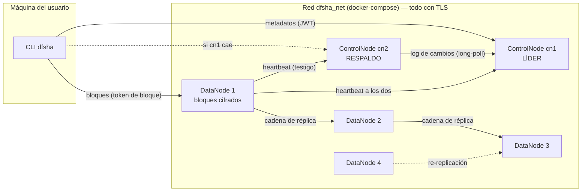
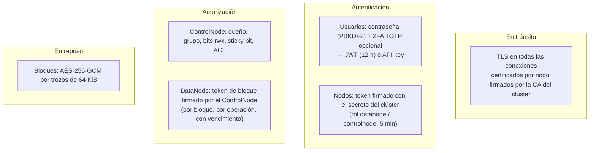
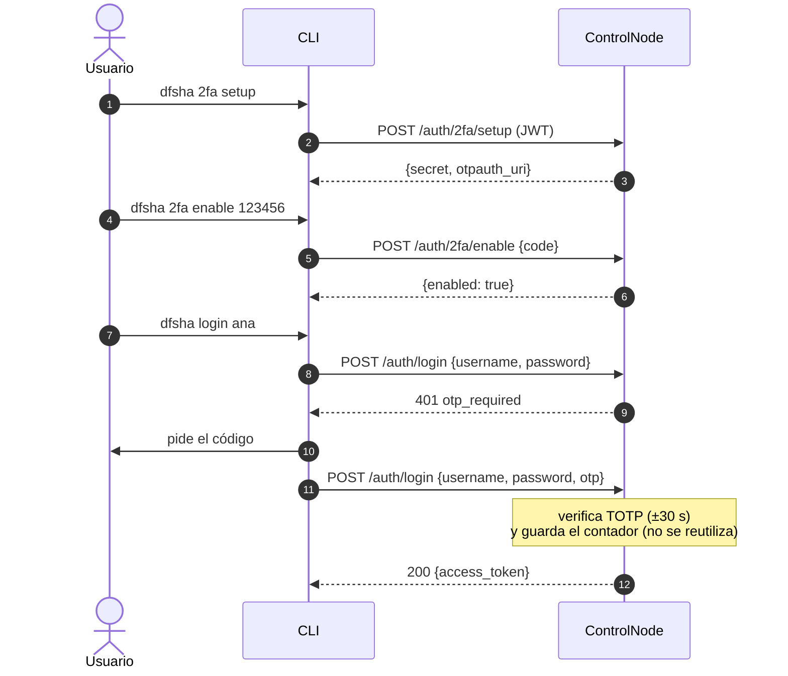
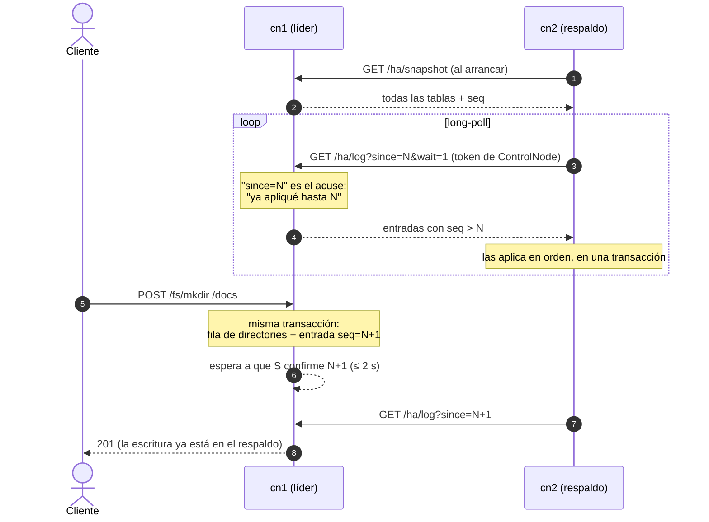
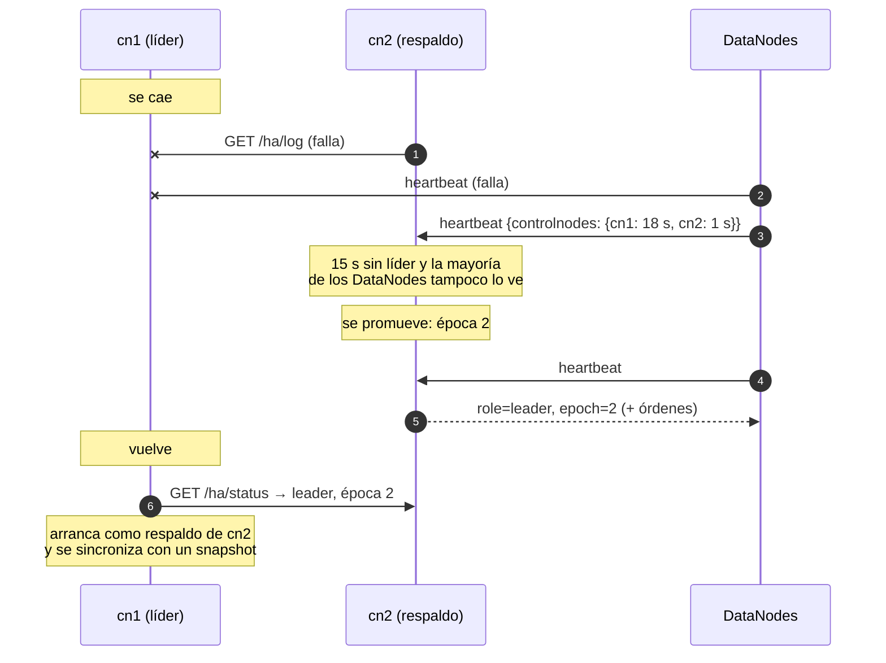
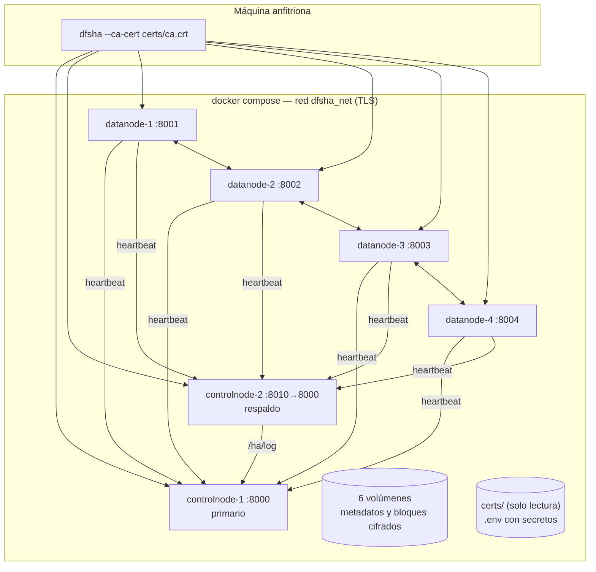

# DFSha — Especificación del Hito 3: alta disponibilidad, replicación, consistencia y seguridad

Este documento extiende la [especificación del Hito 2](ESPECIFICACION_HITO2.md).
Cubre lo que el enunciado pide para el Hito 3 (RNF2, RNF3 y RNF6) y
completa los **cinco** pares de comunicación de la sección 4 del enunciado:

| Par | Para qué | Sección |
|---|---|---|
| Cliente ↔ ControlNode | metadatos, planes de bloques, permisos, locks, 2FA, API keys | [§4](#4-cliente--controlnode) |
| Cliente ↔ DataNode | subida y descarga de bloques con tokens de bloque | [§5](#5-cliente--datanode) |
| ControlNode ↔ ControlNode | réplica de metadatos y failover | [§6](#6-controlnode--controlnode-alta-disponibilidad-de-los-metadatos) |
| ControlNode ↔ DataNode | registro, heartbeat, informes, órdenes de borrado y de copia | [§7](#7-controlnode--datanode) |
| DataNode ↔ DataNode | cadena de réplica y re-replicación | [§8](#8-datanode--datanode-replicación-de-bloques) |

La referencia campo a campo de cada endpoint está en
[`CONTRATOS.md`](../CONTRATOS.md).

---

## 1. Arquitectura



| Componente | Qué cambia en el Hito 3 |
|---|---|
| **ControlNode** | Dos instancias: un líder y un respaldo que replica sus metadatos y toma el control si el líder cae. Sabe en qué DataNodes está cada réplica, re-replica lo que falta y aplica el control de acceso. Firma los tokens de bloque. |
| **DataNode** | Guarda los bloques cifrados (AES-256-GCM) y reenvía cada bloque al siguiente nodo de su cadena de réplica. Solo atiende peticiones con un token de bloque válido. Late a todos los ControlNodes. |
| **Cliente** | Sube cada bloque una sola vez, al primer nodo de la cadena; lee de cualquier réplica y cambia a otra si una falla. Conoce los dos ControlNodes y cambia solo de uno a otro si hay failover. |

## 2. Requisitos del enunciado y dónde se cumplen

| Requisito | Cómo se cumple | Código |
|---|---|---|
| **RNF2** Alta disponibilidad: sin caídas del servicio ni pérdida de datos | Cada bloque en 3 DataNodes; re-replicación automática si uno cae; ControlNode con respaldo y failover automático | `app/replication.py`, `app/ha/`, `datanode/app/main.py` |
| **RNF3** Consistencia | Escritura en dos fases verificada por los DataNodes; bloques inmutables; lecturas sin huecos; locks y leases; réplica semi-síncrona de metadatos; *fencing* por época | `app/routers/control.py`, `app/locks.py`, `app/ha/` |
| **RNF4** Particionamiento | Igual que en el Hito 2, ahora con réplicas | `app/placement.py` |
| **RNF5** Concurrencia | Subidas y bajadas de bloques en paralelo; lectores concurrentes con escritores (versión confirmada); locks compartidos | `cli/dfsha_cli/distributed.py` |
| **RNF6** Cifrado en las comunicaciones | TLS en todas las conexiones (cliente, ControlNodes, DataNodes), con CA propia | `scripts/setup_cluster.py`, `docker-compose.yml` |
| **RNF6** Cifrado en el almacenamiento | Bloques cifrados con AES-256-GCM en cada DataNode | `datanode/app/storage.py` |
| **RNF6** Control de acceso por usuario y grupo | Permisos estilo Unix (dueño, grupo, otros, sticky bit), grupos y ACL; privado por defecto | `app/acl.py`, `app/routers/fs.py`, `app/routers/groups.py` |
| **RNF6** user/password, 2FA, API keys | PBKDF2; TOTP (RFC 6238); API keys con hash; bloqueo por fuerza bruta | `app/routers/auth.py`, `app/security.py` |
| **RNF6** Seguridad entre nodos | Tokens firmados con un secreto de clúster distinto del de los usuarios; tokens de bloque que el DataNode exige | `app/cluster_auth.py`, `datanode/app/security.py` |
| **RF3** `lock()` | Locks exclusivos y compartidos con vencimiento | `app/locks.py` |

---

## 3. Seguridad

### 3.1 Capas



### 3.2 Tokens

Hay dos secretos distintos: `DFSHA_JWT_SECRET` firma los tokens de los
usuarios y `DFSHA_CLUSTER_SECRET` firma los de los nodos y los de bloque.
Un token de usuario nunca sirve para hacerse pasar por un nodo.

| Token | Quién lo firma | Quién lo verifica | Claims | Vida |
|---|---|---|---|---|
| JWT de usuario | ControlNode (`jwt_secret`) | ControlNode | `sub`, `uid`, `exp` | 12 h |
| API key | — (se guarda su SHA-256) | ControlNode | `dfsha_<prefijo>_<secreto>` | sin vencimiento o `expires_in_days` |
| Token de nodo | cada nodo (`cluster_secret`) | ControlNode / DataNode | `typ=node`, `sub=<id>`, `role` | 5 min |
| Token de bloque | ControlNode (`cluster_secret`) | DataNode | `typ=block`, `bid`, `fid`, `op=read\|write`, `pipe` (escritura), `sub` | 1 h |

El **token de bloque** es la pieza central de la autorización en los
DataNodes, al estilo de los *block access tokens* de HDFS:

- El ControlNode lo emite **después** de comprobar los permisos del usuario
  sobre el archivo (`r` para leer, `w` para escribir).
- El DataNode no sabe nada de usuarios ni de ACL: solo comprueba la firma,
  que el token sea de ese bloque y esa operación, y que no haya vencido.
- El token de escritura lleva la cadena de réplica (`pipe`) con las
  direcciones internas de los DataNodes. El DataNode solo acepta si él mismo
  está en la cadena, y reenvía solo a los que le siguen. Como el token va
  firmado, un cliente no puede hacer que un DataNode mande datos a una
  dirección arbitraria (SSRF).

### 3.3 Control de acceso

Es un modelo POSIX simplificado (`app/acl.py`). Cada archivo y directorio
tiene dueño, un grupo opcional, bits de modo (`rwx` para dueño, grupo y
otros, más el *sticky bit*) y entradas de ACL opcionales para usuarios o
grupos concretos.

Permisos efectivos (orden POSIX):

1. Superusuario (`DFSHA_SUPERUSERS`): todo.
2. Dueño: los bits de dueño.
3. Entrada de ACL para el usuario: esos permisos.
4. Miembro del grupo del archivo o de un grupo con ACL: la unión de esos
   permisos.
5. Si no, los bits de "otros".

| Operación | Exige |
|---|---|
| Llegar a algo dentro de un directorio | `x` en él y en todos sus ancestros |
| `ls` | `r` en el directorio |
| Crear (`mkdir`, `put` nuevo) | `w` y `x` en el padre |
| Borrar (`rm`, `rmdir`) | `w` y `x` en el padre; con sticky bit, ser dueño de la entrada o del padre |
| `rm -r` | además, `rwx` en cada directorio del subárbol |
| Leer un archivo (`get`, plan de lectura) | `r` en el archivo |
| Escribir (`put` sobre uno existente, reemplazar un bloque) | `w` en el archivo |
| `chmod`, ACL | ser el dueño |
| `chgrp` | ser el dueño y miembro del grupo destino |

Valores por defecto:

- Lo que crea un usuario es **privado**: `0700` en directorios y `0600` en
  archivos ("cada cliente gestiona solo sus propios archivos").
- Lo nuevo hereda el grupo de su directorio padre.
- La raíz `/` es `1777`, como `/tmp`: todos pueden crear en ella, pero el
  sticky bit hace que solo el dueño de cada entrada pueda borrarla.

El usuario interno `system`, dueño de la raíz, no puede iniciar sesión.

### 3.4 2FA, API keys y fuerza bruta



- **TOTP** según RFC 6238 (HMAC-SHA1, 6 dígitos, pasos de 30 s, ±1 paso de
  tolerancia), compatible con Google Authenticator o Authy. Un código usado
  no vale dos veces.
- **API keys** para scripts: `dfsha apikey create <nombre>`. Se muestran una
  sola vez y se guarda su SHA-256. Se mandan como `X-API-Key` o como
  `Authorization: Bearer dfsha_...`. Con una API key no se pueden crear más
  claves ni tocar el 2FA, así que una clave filtrada no sirve para tomar la
  cuenta.
- **Bloqueo**: 5 intentos fallidos seguidos bloquean el usuario 5 minutos
  (`429 too_many_attempts`).
- El header de desarrollo `X-Username` (sin contraseña) queda **apagado**
  salvo con `DFSHA_ALLOW_INSECURE_DEV_AUTH=true`.

### 3.5 Cifrado en reposo

Cada DataNode cifra sus bloques con su propia clave AES-256
(`DFSHA_DATANODE_STORAGE_KEY`):

```
"DFSE1\n" | prefijo de nonce (7 B) | trozo₀ | trozo₁ | …
trozoᵢ = AES-GCM(clave, nonce = prefijo ‖ último? (1 B) ‖ i (4 B), 64 KiB de contenido, AAD = "DFSE1\n")
```

- Se cifra y descifra en streaming, por trozos de 64 KiB: nunca hay un
  bloque entero en memoria.
- El byte "¿último?" va dentro del nonce. Si alguien trunca el archivo, el
  trozo final que queda no se descifra como último y la lectura falla.
- El `.sha256` guardado junto al bloque es del contenido en claro: el
  DataNode verifica el bloque completo antes de servirlo.

### 3.6 TLS

`scripts/setup_cluster.py` crea una CA propia y un certificado por nodo,
válido para el nombre del servicio, `localhost` y `127.0.0.1`. Todas las
conexiones van por HTTPS: cliente→ControlNode, cliente→DataNode,
DataNode→ControlNode, ControlNode→ControlNode y DataNode→DataNode. Cada
extremo verifica el certificado del otro con la CA. La CLI la recibe con
`--ca-cert certs/ca.crt`.

---

## 4. Cliente ↔ ControlNode

Novedades respecto al Hito 2:

| Método y ruta | Para qué |
|---|---|
| `POST /auth/login` | Ahora con `otp` opcional; `401 otp_required` / `invalid_otp`, `429 too_many_attempts` |
| `GET /auth/2fa`, `POST /auth/2fa/setup`, `/enable`, `/disable` | 2FA |
| `POST/GET /auth/api-keys`, `DELETE /auth/api-keys/{id}` | API keys |
| `POST /fs/chmod`, `POST /fs/chgrp`, `GET/POST/DELETE /fs/acl` | Permisos |
| `POST /groups`, `GET /groups`, `POST /groups/{g}/members`, `DELETE /groups/{g}/members/{u}`, `DELETE /groups/{g}` | Grupos |
| `POST /files/{ruta}/lock`, `POST .../lock/{id}/renew`, `DELETE .../lock/{id}`, `GET .../locks` | Locks (RF3) |
| `GET /cluster/status` | Líder, DataNodes, réplicas, bloques sub-replicados o perdidos |
| `POST /files/{ruta}/allocate` | Ahora devuelve, por bloque, la cadena `datanodes` y un `token`, más el `lease_id` del archivo |
| `GET /files/{ruta}/blocks` | Ahora devuelve todas las réplicas (vivas primero) y un `token` de lectura por bloque |

**Failover transparente.** La CLI guarda los dos ControlNodes
(`-u https://localhost:8000,https://localhost:8010`). Cada petición va al
último que respondió como líder. Si ese no responde, o contesta
`503 not_leader` (es el respaldo), la CLI prueba el otro. El usuario no
tiene que hacer nada.

---

## 5. Cliente ↔ DataNode

### 5.1 Escritura

```mermaid
sequenceDiagram
    autonumber
    participant C as CLI
    participant CN as ControlNode (líder)
    participant D1 as DataNode 1
    participant D2 as DataNode 2
    participant D3 as DataNode 3
    C->>CN: POST /files/a.bin/allocate {size}
    Note over CN: comprueba permisos, toma un lease exclusivo<br/>cadena por bloque: [D1, D2, D3]
    CN-->>C: bloques con cadena + token de escritura, lease_id
    C->>D1: PUT /blocks/b0 (token, X-Checksum-Sha256)
    Note over D1: verifica el token (bloque, operación, D1 ∈ cadena),<br/>cifra y guarda, verifica el checksum
    D1->>CN: POST /datanodes/blocks/received {b0, sha}
    D1->>D2: PUT /blocks/b0 (mismo token)
    D2->>CN: POST /datanodes/blocks/received
    D2->>D3: PUT /blocks/b0
    D3->>CN: POST /datanodes/blocks/received
    D3-->>D2: stored_on [D3]
    D2-->>D1: stored_on [D2, D3]
    D1-->>C: stored_on [D1, D2, D3]
    C->>CN: POST /files/a.bin/confirm {b0, sha, lease_id}
    Note over CN: acepta solo si ≥ min_replicas DataNodes<br/>informaron ESE checksum; libera el lease
    CN-->>C: {complete: true}
```

- El cliente sube cada bloque **una sola vez**: la réplica la hace la cadena
  de DataNodes.
- Si D1 no responde, el cliente sube a D2, que reenvía a D3. La réplica que
  falta la completa luego el re-replicador.
- Si un nodo intermedio falla, el anterior prueba con el siguiente de la
  cadena.
- El ControlNode no se fía del cliente: un bloque solo se confirma si los
  DataNodes informaron haberlo guardado con el mismo checksum que manda el
  cliente. Si los informes aún no llegaron, `confirm` responde
  `409 replicas_not_ready` y la CLI reintenta durante unos segundos.

### 5.2 Lectura

```mermaid
sequenceDiagram
    autonumber
    participant C as CLI
    participant CN as ControlNode
    participant D2 as DataNode 2 (caído)
    participant D3 as DataNode 3
    C->>CN: GET /files/a.bin/blocks
    Note over CN: comprueba r; réplicas vivas primero<br/>(rotadas por índice para repartir carga)
    CN-->>C: b0 → [D2, D3, D1], token de lectura
    C-xD2: GET /blocks/b0
    C->>D3: GET /blocks/b0 (token)
    Note over D3: descifra y verifica contra su .sha256
    D3-->>C: contenido + X-Checksum-Sha256
    Note over C: verifica el checksum del plan<br/>y escribe en su offset
```

Si una réplica falla (caída, `404`, `500 corrupt_block` o un checksum
distinto), la CLI prueba la siguiente. Solo falla si no sirve ninguna, y en
ese caso no deja ningún archivo a medias.

---

## 6. ControlNode ↔ ControlNode: alta disponibilidad de los metadatos

### 6.1 Réplica del log de cambios



- **Captura** (`app/ha/changelog.py`): eventos `after_insert`,
  `after_update` y `after_delete` de **todos** los modelos del ORM. Cada
  fila escrita genera una entrada en `ha_log` con la fila completa en JSON,
  en la misma conexión y transacción. Si la transacción se deshace, la
  entrada también. Ningún router tiene que acordarse de replicar.
- **Orden**: SQLite serializa a los escritores, así que el orden de `seq` es
  el orden de commit.
- **Aplicación**: `INSERT OR REPLACE` o `DELETE` por clave primaria, en
  orden. El respaldo copia las entradas a su propio log con el mismo `seq`,
  para poder servirlas si se promueve.
- **Replicación semi-síncrona** (`app/ha/middleware.py`): el líder no
  responde a una escritura hasta que todos los respaldos sanos la
  confirman, con un máximo de `DFSHA_HA_SYNC_TIMEOUT` (2 s). Con el
  respaldo sano, un failover no pierde ninguna escritura confirmada. Si el
  respaldo está caído o lento, el líder sigue respondiendo (prima la
  disponibilidad) y el respaldo se pone al día después.
- **Snapshot**: un respaldo nuevo, uno que se quedó atrás (el log se poda a
  las últimas 100 000 entradas) o un líder viejo que vuelve pide
  `GET /ha/snapshot`. Así descarta lo que no llegó a replicar.

### 6.2 Failover



Un respaldo se promueve solo si se cumplen las tres condiciones:

1. Lleva `DFSHA_HA_FAILOVER_SECONDS` (15 s) sin contacto con el líder, y
   ningún par responde como líder.
2. **Testigos**: los DataNodes mandan en cada heartbeat cuánto hace que
   hablaron con cada ControlNode. Si la mayoría de los DataNodes con informe
   reciente todavía ve al líder, el respaldo **no** se promueve: está
   aislado por una partición de red y promoverse crearía dos líderes
   (*split-brain*).
3. Si hay varios respaldos, ninguno alcanzable tiene más log aplicado (en
   empate, gana el id menor).

**Épocas (fencing).** Cada promoción sube la época. Un líder que descubre
otro con época mayor se degrada a respaldo y se resincroniza. Los DataNodes
ignoran las órdenes de un líder con época menor a la que ya vieron, así que
un líder viejo que no sabe que lo reemplazaron no puede mandar borrar nada.

**Peticiones a un respaldo.** Responde `503 not_leader` con el header
`X-DFSha-Leader`, salvo `/health`, `/ha/*` y `/datanodes/heartbeat`.

---

## 7. ControlNode ↔ DataNode

| Método y ruta | Quién | Para qué |
|---|---|---|
| `POST /datanodes/register` | DataNode → líder | Alta con dirección pública, dirección interna y esquema |
| `POST /datanodes/heartbeat` | DataNode → **todos** | Liveness, informes atrasados, acuses, testigo; respuesta con órdenes |
| `POST /datanodes/blocks/received` | DataNode → líder | "Guardé este bloque con este checksum", enviado en cuanto lo guarda |
| `POST /datanodes/block-report` | DataNode → líder | Inventario completo, al registrarse y cada 10 min |

Todos exigen un token de nodo con `role=datanode` cuyo `sub` coincida con el
`node_id` del cuerpo: un DataNode no puede hacerse pasar por otro.

**Heartbeat.**

- Petición: `{node_id, deleted_blocks, received_blocks, corrupt_blocks, controlnodes}`.
- Respuesta: `{role, epoch, controlnode_id, delete_blocks, replicate}`.
  - `delete_blocks`: bloques a borrar. Se entregan al-menos-una-vez y tras
    el periodo de gracia.
  - `replicate`: `[{block_id, file_id, token, targets}]`, bloques a copiar a
    otros DataNodes.

**Conciliación del inventario** (`reconcile_report`):

- Una réplica que el ControlNode cree que está en el nodo y no aparece en el
  inventario se da por perdida, y se re-replica.
- Un bloque que el nodo tiene y el namespace no conoce se manda borrar.
- Un bloque conocido del que no había registro en ese nodo se suma como
  réplica.

**Corrupción.** Si un DataNode detecta al leer que un bloque no cuadra con
su checksum, lo informa en `corrupt_blocks`. El líder quita esa réplica y
programa una copia desde una sana.

---

## 8. DataNode ↔ DataNode: replicación de bloques

### 8.1 Colocación

- Allocate: el bloque *i* va a la cadena
  `vivos[(inicio+i) mod k], vivos[(inicio+i+1) mod k], …`, con
  `r = min(factor, k)` nodos distintos, donde *k* es el número de DataNodes
  vivos. `inicio` rota en cada allocate para balancear la carga.
- Re-replicación: el destino es el nodo vivo con menos réplicas, entre los
  que no tienen ya una copia del bloque ni una orden de borrarla.

### 8.2 Re-replicación

```mermaid
sequenceDiagram
    autonumber
    participant CN as ControlNode (líder)
    participant D1 as DataNode 1 (tiene b7)
    participant D2 as DataNode 2 (caído)
    participant D4 as DataNode 4 (destino)
    Note over D2: deja de latir (TTL 30 s)
    Note over CN: cada 5 s: b7 tiene 2 réplicas vivas < 3<br/>→ ReplicationTask(b7, D1 → D4)
    D1->>CN: heartbeat
    CN-->>D1: replicate [{b7, token de escritura para D4, targets: [D4]}]
    D1->>D4: PUT /blocks/b7 (token, checksum)
    D4->>CN: POST /datanodes/blocks/received {b7}
    Note over CN: réplica en D4 = stored; tarea cumplida
    Note over D2: vuelve: 4 réplicas vivas > 3
    Note over CN: quita la sobrante del nodo más cargado<br/>(orden de borrado con gracia)
```

- Las réplicas de un nodo muerto no se borran de la tabla: si el nodo
  vuelve, cuentan otra vez, y las que sobren se eliminan.
- Una orden enviada y no cumplida se reenvía a los 30 s. Si vence
  (`DFSHA_REPLICATION_TASK_TIMEOUT`, 120 s), se reprograma. El destino de la
  copia vencida se manda limpiar, por si quedó a medias, y no se reutiliza
  hasta que lo acuse.
- Un bloque sin ninguna réplica viva cuenta como **perdido** en
  `/cluster/status`. El cliente recibe un error claro al leerlo, nunca datos
  corruptos.

---

## 9. Modelo de consistencia

| Garantía | Mecanismo |
|---|---|
| Un archivo solo es visible completo | Escritura en dos fases: el plan de lectura solo incluye bloques confirmados |
| Lo confirmado está guardado de verdad | `confirm` exige informes de los DataNodes con el mismo checksum |
| Un bloque nunca cambia | Bloques inmutables: contenido nuevo = `block_id` nuevo; el DataNode rechaza sobrescribir (`409 block_exists`) y un reenvío idéntico es un no-op |
| Las lecturas no ven huecos | Un reemplazo de bloque no se sirve hasta confirmarse; el bloque viejo se sigue sirviendo hasta entonces |
| Una lectura en curso no se rompe | Periodo de gracia (`DFSHA_DELETION_GRACE_SECONDS`, 60 s) antes de ordenar borrar un bloque viejo |
| Dos escritores no se pisan | Lease exclusivo implícito en allocate (se libera al confirmar) y locks explícitos `exclusive`/`shared` con vencimiento |
| Las escrituras sobreviven a un failover | Réplica semi-síncrona del log de metadatos |
| No hay dos líderes | Testigos (DataNodes) para el failover y épocas para el fencing |
| Las réplicas convergen | Re-replicación, eliminación de sobrantes, conciliación por inventario, detección de corrupción |

En términos del teorema CAP:

- Ante la caída del líder, el sistema prioriza la **consistencia**: el
  respaldo solo se promueve con la confirmación de los testigos, y durante
  esos segundos el clúster no acepta escrituras de metadatos.
- Ante la caída de un DataNode, prioriza la **disponibilidad**: las
  lecturas siguen desde otras réplicas y las escrituras usan los nodos
  vivos.

---

## 10. Despliegue con docker-compose



```bash
pip install cryptography && python scripts/setup_cluster.py   # certs/ y .env (no van a git)
docker compose up --build -d
pip install -e ./cli
dfsha login ana -u https://localhost:8000,https://localhost:8010 --ca-cert certs/ca.crt
python scripts/verify_hito3.py                                 # verificación con caídas
```

### 10.1 Variables nuevas

| Variable | Componente | Default | Uso |
|---|---|---|---|
| `DFSHA_CLUSTER_SECRET` | todos | dev | Tokens de nodo y de bloque |
| `DFSHA_REPLICATION_FACTOR` / `DFSHA_MIN_REPLICAS` | ControlNode | 3 / 1 | Réplicas por bloque / mínimas para confirmar |
| `DFSHA_REPLICATION_CHECK_INTERVAL` | ControlNode | 5 s | Periodo del re-replicador |
| `DFSHA_DELETION_GRACE_SECONDS` | ControlNode | 60 s | Gracia antes de borrar bloques viejos |
| `DFSHA_LEASE_TTL_SECONDS` | ControlNode | 120 s | Duración de leases y locks |
| `DFSHA_CONTROLNODE_ID`, `DFSHA_HA_PEERS`, `DFSHA_HA_INITIAL_ROLE` | ControlNode | cn1, —, primary | Grupo de HA |
| `DFSHA_HA_FAILOVER_SECONDS` / `DFSHA_HA_SYNC_TIMEOUT` | ControlNode | 15 s / 2 s | Failover / espera semi-síncrona |
| `DFSHA_SUPERUSERS`, `DFSHA_ALLOW_INSECURE_DEV_AUTH` | ControlNode | — / false | Administración / X-Username |
| `DFSHA_TLS_CERT`, `DFSHA_TLS_KEY`, `DFSHA_CA_CERT` | todos | — | TLS |
| `DFSHA_CONTROLNODE_URLS` | DataNode | — | ControlNodes (líder y respaldos) |
| `DFSHA_DATANODE_INTERNAL_HOST` / `_PORT` | DataNode | = anunciado | Dirección para los otros DataNodes |
| `DFSHA_DATANODE_STORAGE_KEY` | DataNode | — | Clave AES-256 (base64) |
| `DFSHA_BASE_URL` (lista), `DFSHA_CA_CERT` | CLI | — | ControlNodes y CA |

### 10.2 El clúster en ejecución

Salida real (12 de octubre de 2026) de `docker compose up --build -d` y
`python scripts/verify_hito3.py`, con TLS y las caídas inyectadas por el
script. Solo se abreviaron los nombres de usuario, que el script genera con
un sufijo aleatorio (`anaf76f97` → `ana`):

```console
$ docker compose ps
NAME                  IMAGE                     STATUS                    PORTS
dfsha-controlnode-1   dfsha-controlnode:hito3   Up 25 seconds (healthy)   0.0.0.0:8000->8000/tcp
dfsha-controlnode-2   dfsha-controlnode:hito3   Up 2 minutes (healthy)    0.0.0.0:8010->8000/tcp
dfsha-datanode-1      dfsha-datanode:hito3      Up 2 minutes              0.0.0.0:8001->8001/tcp
dfsha-datanode-2      dfsha-datanode:hito3      Up 55 seconds             0.0.0.0:8002->8002/tcp
dfsha-datanode-3      dfsha-datanode:hito3      Up 2 minutes              0.0.0.0:8003->8003/tcp
dfsha-datanode-4      dfsha-datanode:hito3      Up 2 minutes              0.0.0.0:8004->8004/tcp

$ python scripts/verify_hito3.py
[1] Replicación de bloques
  ✓ put por la cadena de réplica
  ✓ 9 bloques × 3 réplicas = 27 réplicas, ninguno sub-replicado
  ✓ repartidos entre ['datanode-1', 'datanode-2', 'datanode-3', 'datanode-4']
[2] Seguridad
  ✓ HTTP plano rechazado: solo TLS
  ✓ certificado del clúster no confiable sin la CA (no hay MITM sin la CA)
  ✓ bob no puede leer el archivo privado de ana (403)
  ✓ DataNode sin token de bloque -> 401
  ✓ token de otro bloque -> 403
  ✓ bloques cifrados en disco (el contenido no aparece en claro)
[3] Consistencia: lock exclusivo
  ✓ con el lock de ana, bob no puede escribir (409 file_locked)
[4] Alta disponibilidad de datos: cae datanode-2
  ✓ lectura idéntica con datanode-2 caído
  ✓ el líder re-replicó los bloques de datanode-2 en los otros 3 nodos (38 s)
  ✓ datanode-2 volvió y se quitaron las réplicas sobrantes (4 s)
[5] Alta disponibilidad del ControlNode: cae el líder
  ✓ controlnode-2 tomó el control (16 s)
  ✓ la CLI lee tras el failover (sin reconfigurar nada)
  ✓ la CLI escribe tras el failover
  ✓ controlnode-1 volvió como respaldo del nuevo líder (2 s)
  ✓ controlnode-1 tiene el archivo escrito mientras estaba caído (0 s)
TODO OK — replicación, seguridad, consistencia y alta disponibilidad funcionan.

$ dfsha status          # después de la prueba: cn2 quedó como líder (época 2)
ControlNode cn2: leader (época 2) en https://localhost:8010
  respaldo cn1: log confirmado hasta 369
            DataNodes (factor de replicación 3)
┏━━━━━━━━━━━━┳━━━━━━━━━━━━━━━━━━━━━━━━┳━━━━━━━━┳━━━━━━━━━━┓
┃ Nodo       ┃ Dirección              ┃ Estado ┃ Réplicas ┃
┡━━━━━━━━━━━━╇━━━━━━━━━━━━━━━━━━━━━━━━╇━━━━━━━━╇━━━━━━━━━━┩
│ datanode-1 │ https://localhost:8001 │ vivo   │        2 │
│ datanode-2 │ https://localhost:8002 │ vivo   │        2 │
│ datanode-3 │ https://localhost:8003 │ vivo   │        3 │
│ datanode-4 │ https://localhost:8004 │ vivo   │        2 │
└────────────┴────────────────────────┴────────┴──────────┘
1 archivo(s), 3 bloque(s)
sub-replicados: 0 · sin réplica viva: 0 · copias en curso: 0 · borrados pendientes: 37
```

---

## 11. Límites conocidos

- **HA del ControlNode con dos nodos.** Está probado con un líder y un
  respaldo. Los testigos evitan el *split-brain* ante una partición entre
  los ControlNodes, pero no hay un consenso completo (Raft/Paxos). Con más
  de dos ControlNodes la lógica está, pero no se probó.
- **Ventana de pérdida.** Si el respaldo tarda más de `ha_sync_timeout` en
  confirmar, el líder responde igual. Si cae justo en ese momento, esas
  escrituras se pierden en el failover. Los bloques que hubieran quedado
  huérfanos en los DataNodes se limpian por inventario.
- **Metadatos en claro en el ControlNode.** El SQLite no está cifrado.
  Contiene nombres, permisos y hashes de contraseñas, pero ningún
  contenido de archivos.
- **Ruta heredada del Hito 1.** El `PUT/GET /files/{ruta}` monolítico guarda
  el archivo entero en el ControlNode, sin replicar ni cifrar. La CLI ya no
  lo usa para subir.
- **Bloqueo por fuerza bruta en memoria.** Es por ControlNode: tras un
  failover el contador vuelve a cero.
- **Rotación de claves.** No hay rotación de la clave de cifrado de los
  DataNodes ni de los secretos del clúster.
