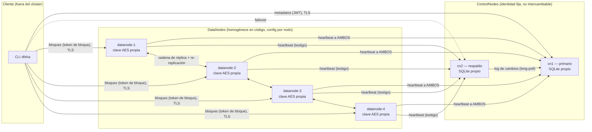

# Brief de arquitectura — DFSha (estado actual, fin de Hito 3)

> Documento de entrada para el proyecto de despliegue en AWS/EKS con
> Terraform. Resume, desde el punto de vista de infraestructura, qué hay
> que desplegar, cómo se relacionan sus piezas y qué implicaciones tiene
> cada decisión de diseño de la aplicación sobre el despliegue. No
> propone todavía ninguna solución de infraestructura: eso es el
> siguiente documento (`02-plan-implementacion.md`).
>
> Fuentes: `README.md`, `docs/ESPECIFICACION_HITO2.md`,
> `docs/ESPECIFICACION_HITO3.md`, `docker-compose.yml`, `Dockerfile`,
> `datanode/Dockerfile`, `app/config.py`, `scripts/setup_cluster.py`.

---

## 1. Resumen ejecutivo

DFSha es un sistema de archivos distribuido por bloques, al estilo HDFS,
compuesto por **dos tipos de servicio con estado** (ControlNode y
DataNode) y un **cliente** (CLI) que habla directamente con ambos. El
estado actual del repo (Hito 3) ya implementa alta disponibilidad del
ControlNode (líder/respaldo), replicación de bloques entre DataNodes,
TLS de extremo a extremo con CA propia y control de acceso tipo Unix.

Hoy el único mecanismo de despliegue es `docker-compose.yml`, con una
topología **fija**: 2 ControlNodes + 4 DataNodes, cada uno como un
servicio nombrado explícitamente (no hay un `Deployment` genérico
escalable). Migrar esto a EKS implica resolver tres problemas que
docker-compose no tiene que resolver: identidad estable por nodo,
direcciones "anunciadas" (`advertise host/port`) que los clientes deben
poder resolver desde fuera del clúster, y gestión de secretos/certificados
que hoy genera un script local y vive en un `.env` fuera de git.

---

## 2. Tipos de nodo

### 2.1 ControlNode (`app/`)

| | |
|---|---|
| **Rol** | Metadatos (namespace de archivos/directorios), tabla de bloques y sus réplicas, usuarios/auth, ACL, locks, coordinación de HA, firma de tokens de nodo y de bloque. Es el "NameNode". |
| **Instancias** | Exactamente **2** en el estado actual del repo: `cn1` (arranca como primario) y `cn2` (arranca como respaldo). El código soporta más peers de HA pero **no está probado** con más de 2 (ver §11 de `ESPECIFICACION_HITO3.md`). |
| **Identidad** | Cada instancia tiene un `DFSHA_CONTROLNODE_ID` propio (`cn1`/`cn2`) y conoce a sus pares por URL fija (`DFSHA_HA_PEERS`). La identidad **no es intercambiable**: no se puede escalar "ControlNode" como una réplica homogénea; cada una cumple un rol distinto (primario arranca con `DFSHA_HA_INITIAL_ROLE=primary`, la otra `standby`). |
| **Estado persistente** | SQLite en `/data/dfsha.db` (un volumen por instancia). El respaldo mantiene su propia copia, sincronizada por el log de cambios (`/ha/log`, long-poll) y por snapshot al arrancar. |
| **Puerto** | `8000` interno (HTTP o HTTPS según haya `DFSHA_TLS_CERT`/`KEY`). En compose se publican como `8000` (cn1) y `8010→8000` (cn2) porque el cliente necesita **ambas** direcciones para el failover transparente. |
| **Healthcheck** | `GET /health` (sirve también sin TLS verificado: usa `ssl._create_unverified_context()` en el healthcheck del propio compose). |
| **Comunicación saliente** | Ninguna hacia DataNodes (el ControlNode nunca llama a un DataNode). Sí hacia su par ControlNode (long-poll del log de cambios). |
| **Comunicación entrante** | Del cliente (metadatos, JWT), de los DataNodes (heartbeat, register, block-report — autenticado con token de nodo), del otro ControlNode (`/ha/*`, token de ControlNode). |
| **Secretos que necesita** | `DFSHA_JWT_SECRET`, `DFSHA_CLUSTER_SECRET` (compartido con todos los nodos), certificado TLS propio + `ca.crt`. |
| **Particularidad crítica** | Un respaldo caído que vuelve se resincroniza solo; pero **promover mal a un respaldo (split-brain) es el escenario que más cuidado exige** — depende de que los DataNodes reporten testigos fiables, lo cual depende de que la red entre DataNodes y ambos ControlNodes esté bien enrutada. |

### 2.2 DataNode (`datanode/`)

| | |
|---|---|
| **Rol** | Guarda bloques cifrados (AES-256-GCM) en disco, uno por archivo-directorio (`<storage>/<file_id>/<block_id>`). Nunca tiene el archivo completo. Reenvía cada bloque al siguiente nodo de su cadena de réplica (DataNode → DataNode). Es el "DataNode" de HDFS. |
| **Instancias** | **4** en el estado actual (`datanode-1..4`), homogéneas en código pero **no intercambiables en configuración**: cada una tiene su propio `DFSHA_DATANODE_ID`, su propio puerto anunciado (`8001`-`8004`) y su propia clave de cifrado en reposo (`DFSHA_DNx_STORAGE_KEY`, una AES-256 distinta por nodo). |
| **Estado persistente** | Un volumen por nodo con los bloques cifrados + su `.sha256` en claro. Factor de replicación por defecto **3** (`DFSHA_REPLICATION_FACTOR`), así que con 4 nodos cada bloque vive en 3 de los 4. |
| **Puerto** | El mismo valor se usa para **escuchar** y para **anunciarse** (`DFSHA_DATANODE_ADVERTISE_PORT` = puerto de escucha de uvicorn). Esto es importante: no hay separación entre "puerto interno" y "puerto público". |
| **Direcciones** | Dos conceptos distintos y configurables por separado: `DFSHA_DATANODE_ADVERTISE_HOST`/`PORT` (lo que el ControlNode entrega al **cliente** en el plan de lectura/escritura) y `DFSHA_DATANODE_INTERNAL_HOST`/`PORT` (lo que usan **otros DataNodes** para la cadena de réplica). En compose, el `advertise_host` es `localhost` (porque el cliente corre en el host) y el `internal_host` es el nombre del servicio Docker. **Esta distinción es exactamente el problema que hay que resolver en EKS**: el cliente ya no corre "en el host" sino fuera del clúster, y el nombre interno de Kubernetes no sirve para anunciarse a un cliente externo. |
| **Comunicación saliente** | Heartbeat a **todos** los ControlNodes cada `DFSHA_HEARTBEAT_INTERVAL` (10 s por defecto); `blocks/received` y `block-report` al líder; reenvío de bloques al siguiente nodo de la cadena de réplica. |
| **Comunicación entrante** | Del cliente (bloques, con token de bloque), de otros DataNodes (cadena de réplica y re-replicación). |
| **Secretos que necesita** | `DFSHA_CLUSTER_SECRET`, su propia `DFSHA_DATANODE_STORAGE_KEY`, certificado TLS propio + `ca.crt`. |
| **Escalamiento** | Es el tipo de nodo pensado para escalar horizontalmente ("para escalar a N DataNodes basta con copiar un servicio con otro id, puerto y volumen" — README). Es el candidato natural para gestionar como un `StatefulSet` con réplicas variables en EKS, que es justo lo que pide el resultado esperado ("despliegue de nodos variables"). |

### 2.3 Cliente (CLI, `cli/`)

| | |
|---|---|
| **Rol** | No es un servicio desplegado en el clúster. Corre en la máquina del usuario/operador. Parte archivos en bloques, habla **directo** con ControlNode (metadatos) y con cada DataNode (bytes), reensambla y verifica checksums. |
| **Descubrimiento** | Recibe explícitamente las URLs de ambos ControlNodes (`-u https://host1:8000,https://host2:8010`) y el `ca.crt` del clúster. A partir de ahí, el ControlNode le dice en cada `allocate`/`blocks` a qué DataNodes conectarse (host:puerto *anunciados*). |
| **Implicación de infraestructura** | El cliente necesita alcanzar por red **cada ControlNode y cada DataNode individualmente**, no solo un load balancer único: la transparencia de localización funciona porque el ControlNode entrega direcciones reales y navegables. Cualquier capa de red que se interponga (NAT, un solo Ingress) tiene que preservar esa alcanzabilidad nodo a nodo, o el `advertise_host/port` de cada nodo tiene que apuntar a algo que sí sea alcanzable desde fuera. |

### 2.4 Relación entre tipos de nodo (resumen)

---

## 3. Relaciones de comunicación (los 5 pares del enunciado)

| Par | Quién inicia | Transporte | Autenticación | Notas para infraestructura |
|---|---|---|---|---|
| Cliente ↔ ControlNode | Cliente | HTTPS (TLS, CA propia) | JWT de usuario / API key | El cliente debe poder alcanzar **ambos** ControlNodes para el failover; conoce sus URLs de antemano (no hay descubrimiento dinámico). |
| Cliente ↔ DataNode | Cliente | HTTPS (TLS) | Token de bloque (firmado por el ControlNode, 1 h, por bloque y operación) | El cliente recibe la dirección del DataNode **del ControlNode**, no la configura él mismo. Esa dirección es `advertise_host:advertise_port`. |
| ControlNode ↔ ControlNode | El respaldo (long-poll) | HTTPS (TLS) | Token de nodo (`role=controlnode`) | Tráfico interno frecuente y de baja latencia (long-poll + réplica semi-síncrona con timeout de 2 s) — sensible a latencia de red entre pods/nodos. |
| ControlNode ↔ DataNode | Siempre el DataNode | HTTPS (TLS) | Token de nodo (`role=datanode`) | El ControlNode **nunca** abre conexión saliente hacia un DataNode; esto simplifica reglas de red (solo necesitan alcanzar el ControlNode, no al revés) pero las órdenes (borrar, replicar) viajan en la respuesta del heartbeat, con reintentos. |
| DataNode ↔ DataNode | El DataNode origen de la cadena/re-replicación | HTTPS (TLS) | Token de bloque (cadena) | Usa la dirección **interna**, no la anunciada. En Kubernetes esto es tráfico pod-a-pod dentro del clúster (o Service ClusterIP), distinto del tráfico anunciado al cliente externo. |

Puntos duros para el diseño de red en AWS:

- **Dos sistemas de direccionamiento conviven a propósito**: el "anunciado" (para el cliente, debe ser accesible desde fuera) y el "interno" (para DataNode↔DataNode y DataNode→ControlNode, puede quedarse dentro del clúster). En Kubernetes esto se traduce naturalmente a un *Service* interno (ClusterIP/headless) para lo interno y algo externamente alcanzable (NodePort/LoadBalancer/Ingress con SNI, o IP de nodo) para lo anunciado — a decidir en el plan de implementación.
- **TLS exige que el `Common Name`/SAN del certificado coincida con el nombre usado para conectar.** Hoy `setup_cluster.py` genera certificados para `controlnode-1`, `controlnode-2`, `datanode-1..4`, `localhost` y `127.0.0.1`. Al mover esto a AWS, cualquier nuevo nombre de host (DNS interno de K8s, un *Service* de EKS, una IP elástica) necesita estar en el SAN del certificado del nodo correspondiente, o el cliente/los pares rechazarán la conexión.
- **El ControlNode nunca llama al DataNode** — esto favorece un modelo donde el *Security Group*/*NetworkPolicy* de los DataNodes solo necesita permitir tráfico saliente hacia los ControlNodes y entre sí, no entrante desde ellos.

---

## 4. Interfaces de usuario actuales

No hay interfaz web. Las dos superficies de uso son:

1. **CLI `dfsha`** (`cli/dfsha_cli/`, instalable con `pip install -e ./cli`): `login`, `put`/`get`, `ls`/`mkdir`/`rm`/`stat`, `chmod`/`chgrp`/`acl`/`group`, `lock`, `2fa`, `apikey`, `nodes`, `status`. Guarda sesión en `~/.dfsha/session.json`. Recibe las URLs del clúster y el CA cert como parámetros (`-u`, `--ca-cert`).
2. **API REST** directa (`curl`), documentada endpoint a endpoint en `CONTRATOS.md`: útil para scripting/CI de verificación, no pensada como interfaz de usuario final.

Para el entorno de pruebas en AWS, esto significa que el "cliente" de validación post-despliegue es la propia CLI (o `scripts/verify_hito2.py` / `verify_hito3.py`) ejecutada desde fuera del clúster, apuntando a las URLs públicas que exponga la infraestructura.

---

## 5. Build y empaquetado actual (Docker)

| | ControlNode | DataNode |
|---|---|---|
| Imagen base | `python:3.11-slim` | `python:3.11-slim` |
| Contenido | `app/` + `requirements.txt` | `datanode/app/` + `datanode/requirements.txt` |
| Volumen | `/data` (DB + bloques heredados del Hito 1) | `/data` (bloques cifrados) |
| Puerto expuesto | `8000` | `${DFSHA_DATANODE_ADVERTISE_PORT}` (variable, no fijo en la imagen) |
| TLS | Activado si `DFSHA_TLS_CERT`/`KEY` están seteados; si no, HTTP plano | Igual |
| Arranque | `uvicorn app.main:app` directo, sin proceso supervisor, sin multi-stage build | Igual |

Nada en el Dockerfile asume docker-compose específicamente — son imágenes genéricas que leen todo por variables de entorno, lo cual es favorable para migrarlas a Kubernetes sin tocar el `Dockerfile` ni el código de la aplicación (coherente con la restricción de no modificar la app). Las imágenes no están publicadas en ningún registro: compose las construye localmente (`build: .` / `build: ./datanode`). Para EKS se necesitará un registro de imágenes (ECR) — esto es infraestructura, no modificación de la app.

---

## 6. Gestión de secretos y certificados (estado actual)

`scripts/setup_cluster.py` es un script **local, manual, fuera de git**, que:

- Genera una CA propia (ECDSA P-256) y un certificado por nodo (SAN = nombre de servicio + `localhost` + `127.0.0.1`), válidos 825 días.
- Genera `.env` con `DFSHA_JWT_SECRET`, `DFSHA_CLUSTER_SECRET` y una `DFSHA_DN<i>_STORAGE_KEY` por DataNode.
- Estos archivos (`certs/`, `.env`) se montan como volumen de solo lectura en cada contenedor.

Para AWS esto apunta directamente a **AWS Secrets Manager / SSM Parameter Store** (secretos) y a decidir si la CA se sigue generando igual (y sus certificados se inyectan como Kubernetes Secrets) o si se delega en algo gestionado — decisión para el plan de implementación, no para este brief. Importante: el script usa la librería `cryptography` y no depende de Docker ni de compose, así que puede seguir ejecutándose igual para producir los materiales que luego Terraform/Kubernetes distribuyen.

---

## 7. Qué NO cambia (restricciones ya confirmadas con el usuario)

- No se crea ni modifica infraestructura en este documento (es solo análisis).
- No se despliegan contenedores todavía.
- No se toca el código de la aplicación: todo lo identificado como "necesario para EKS" (nombres anunciados, registro de imágenes, gestión de secretos) se resuelve por configuración/infraestructura, no por cambios en `app/` o `datanode/app/`.
- No se lee contenido de `.env` ni de `certs/*.key` reales si existieran en el entorno (son generados y gitignored; este análisis se basó solo en el script que los genera, no en secretos materializados).

---

## 8. Implicaciones directas para el plan de implementación (adelanto)

Estas son observaciones, no decisiones — se formalizan en `02-plan-implementacion.md`:

1. **Identidad estable por nodo** (ControlNode primario vs respaldo; cada DataNode con su propia clave de cifrado) empuja hacia `StatefulSet` en Kubernetes, no `Deployment`, para ambos tipos de nodo.
2. **El factor de replicación (3) y el número de DataNodes (4) son independientes** — el sistema ya tolera un número variable de DataNodes vivos (`vivos[... mod k]`), lo cual encaja bien con el requisito de "nodos variables" del resultado esperado, siempre que el mecanismo de *advertise host* seguido por cada réplica nueva quede resuelto en K8s (Service headless + DNS estable, o IP de nodo).
3. **El salto de "una instancia" a "N instancias en cómputo separado" a "EKS" (los 3 pasos pedidos)** debería usar el **mismo artefacto de configuración de la aplicación** en los tres pasos (mismas imágenes, mismas variables `DFSHA_*`), cambiando solo cómo se provisiona cómputo/red — eso es, en esencia, lo que ya hace bien el diseño actual (todo por env vars).
4. **TLS con CA propia y SAN fijos es el punto de mayor fricción** al cambiar de topología de red; conviene decidir pronto si EKS usa el mismo esquema (certs por nodo generados y montados como Secrets) o si se apoya en algo distinto, antes de automatizar el resto.

---

**Siguiente documento:** `docs/deployment/02-plan-implementacion.md` — plan incremental de 3 pasos (instancia única → N instancias separadas → EKS/Kubernetes).
