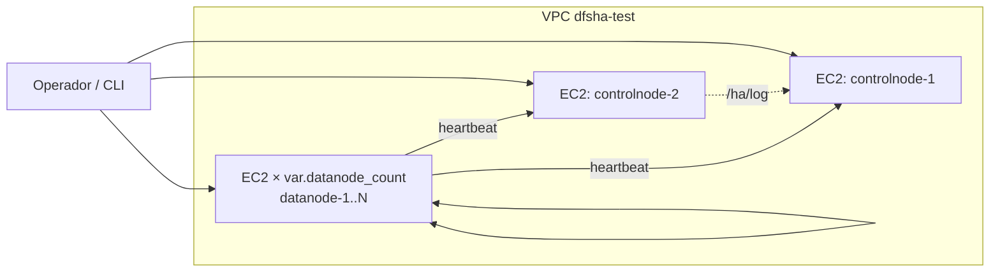
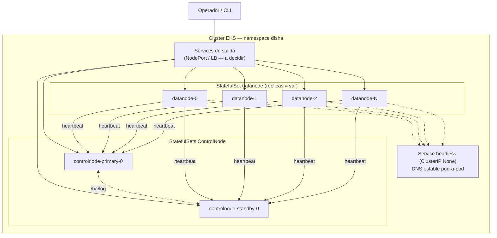

# Plan de implementación incremental — DFSha en AWS con Terraform

> Construye sobre `01-brief-arquitectura.md`. Define **qué** se construye
> en cada uno de los 3 pasos acordados y **qué decisiones quedan
> abiertas**. Las decisiones abiertas se marcan `[VALIDAR]` y se
> consolidan en la §5 para resolverlas antes (o durante) la etapa 3 de
> atomización de tareas. Este documento no crea ni modifica
> infraestructura: es planeación.

Los 3 pasos, tal como los pidió el usuario:

1. **Paso 1** — Despliegue completo en una sola instancia de cómputo.
2. **Paso 2** — Despliegue de *N* nodos en instancias de cómputo separadas.
3. **Paso 3** — Despliegue con EKS y Kubernetes (nodos variables).

Cada paso debe quedar **desplegable y verificable de forma independiente**
(con `scripts/verify_hito2.py` / `verify_hito3.py` o la CLI `dfsha`) antes
de pasar al siguiente, y cada paso reutiliza, sin tocarlas, las mismas
imágenes Docker y el mismo contrato de variables `DFSHA_*` que ya existen
en el repo.

---

## 0. Principios transversales (aplican a los 3 pasos)

Estos principios se fijan una vez y no se repiten en cada paso:

- **No se modifica código de la aplicación.** Todo lo que cambia entre
  "docker-compose en un laptop" y "EKS en AWS" se resuelve con variables
  de entorno (`DFSHA_*`, ya parametrizadas), manifiestos de
  infraestructura y, cuando haga falta, pequeños *wrappers* de
  arranque en la capa de infraestructura (p. ej. un `command:` de
  Kubernetes que calcule un valor y lo exporte) — nunca cambios en
  `app/`, `datanode/app/` o `cli/`.
- **Terraform nunca lee ni genera secretos de aplicación.** La
  generación de certificados y claves sigue siendo
  `scripts/setup_cluster.py`, ejecutado por el operador **fuera** de
  Terraform. Terraform solo crea los "contenedores" del secreto (bucket
  S3, entrada de Secrets Manager, objeto `Secret` de Kubernetes *vacío* o
  con `lifecycle.ignore_changes` sobre su `data`) y nunca referencia su
  contenido real en el plan ni en el state si se puede evitar.
  `[VALIDAR]` mecanismo exacto de entrega del secreto en cada paso (ver
  por paso más abajo).
- **Reutilización de identidad de nodo.** `scripts/setup_cluster.py` ya
  fija los nombres `controlnode-1`, `controlnode-2`, `datanode-1..4`
  como `CN`/SAN de cada certificado. Mientras el entorno de AWS use esos
  mismos nombres como identidad interna (hostname, nombre de servicio
  K8s), los certificados generados hoy siguen sirviendo sin cambios.
  `[VALIDAR]` si hace falta ampliar el SAN para nombres DNS adicionales
  de AWS (ver Paso 2 y Paso 3) y, de ser así, si eso se resuelve pasando
  más nombres como argumento al script (sin tocar su lógica) o si
  requiere editarlo — en cuyo caso se trata como cambio de
  infraestructura/tooling, no de la aplicación en sí, pero debe
  acordarse explícitamente por el riesgo de interpretarse como "tocar la
  app".
- **Registro de imágenes.** Las tres etapas necesitan las imágenes
  `dfsha-controlnode` y `dfsha-datanode` en algún sitio accesible desde
  AWS. Se propone un único repositorio ECR por imagen, creado por
  Terraform, con el **build y push hechos a mano por el operador**
  (`docker build && docker push`), documentado como comando, no
  automatizado — no hay pipeline CI/CD en el alcance. `[VALIDAR]`
  confirmar que un push manual es aceptable para las 3 etapas (incluida
  la 1, donde incluso podría bastar con `docker build` directo en la
  instancia, sin ECR — ver Paso 1).
- **Terraform state.** `[VALIDAR]` backend de estado: local (más simple,
  suficiente para un entorno de pruebas de una sola persona) vs. remoto
  (S3 + DynamoDB lock, más robusto si varias personas del equipo
  aplican cambios). Se recomienda **local** para Paso 1 y **remoto**
  desde Paso 2 en adelante, dado que ya hay más recursos con estado
  cruzado (red, DNS).
- **Cuenta, región y credenciales de AWS.** `[VALIDAR]` cuenta/perfil de
  AWS a usar, región (se asume `us-east-1` por defecto salvo indicación
  contraria) y el método de autenticación de Terraform (perfil nombrado
  vs variables `AWS_ACCESS_KEY_ID`/`SECRET`) — ninguno de estos datos se
  ha visto en el repo ni se debe commitear.
- **Layout del código Terraform.** Se propone un directorio nuevo
  `infra/` en la raíz del repo (fuera de `docs/`), con subcarpetas por
  paso y módulos compartidos:
  ```
  infra/
  ├── modules/
  │   ├── dfsha-network/      # VPC, subnets, security groups (paso 2+)
  │   ├── dfsha-ecr/          # repos de imágenes
  │   └── dfsha-eks/          # cluster, node groups (paso 3)
  ├── 01-single-instance/
  ├── 02-multi-instance/
  └── 03-eks/
  ```
  `[VALIDAR]` nombre y ubicación exactos del directorio, y si cada paso
  vive en su propio *root module* (como arriba, recomendado: permite
  tener los 3 entornos vivos en paralelo para comparar) o si el Paso 2
  reemplaza al Paso 1.
- **Reversibilidad.** Todo lo desplegado en AWS en este proyecto es
  para un entorno de pruebas: cada paso debe poder destruirse por
  completo con `terraform destroy` sin dejar recursos huérfanos
  (Elastic IPs, volúmenes EBS no asociados, Load Balancers). Esto se
  verifica explícitamente como parte de los criterios de éxito de cada
  paso (§4), y cualquier `destroy` real se ejecuta solo con confirmación
  explícita del usuario en su momento.

---

## 1. Paso 1 — Instancia única

### Objetivo
Reproducir exactamente la topología de `docker-compose.yml` (2
ControlNodes + 4 DataNodes) en **una sola** instancia EC2, usando Docker
Compose dentro de ella. Valida que Terraform puede provisionar cómputo,
red básica y entregar el material de arranque, sin todavía resolver
ningún problema de direccionamiento distribuido (todo vive en
`localhost` dentro de la instancia, igual que en un laptop).

### Qué crea Terraform
- Red: `[VALIDAR]` VPC por defecto de la cuenta/región vs. una VPC nueva
  mínima (1 subnet pública). Se recomienda **VPC nueva mínima** para no
  depender del estado de la cuenta y dejar el entorno autocontenido.
- Un *security group* con entrada en los puertos `8000, 8010,
  8001-8004` (los mismos que publica `docker-compose.yml`) desde
  `[VALIDAR]` IP(s) del operador — nunca `0.0.0.0/0` en un entorno con
  TLS mutuo pero credenciales reales de por medio.
- Una instancia EC2 `[VALIDAR]` tipo (se asume `t3.medium` como punto de
  partida: 6 procesos uvicorn + SQLite, carga ligera de laboratorio;
  ajustar tras medir).
- Acceso administrativo a la instancia: `[VALIDAR]` SSH con *key pair*
  nuevo generado por Terraform vs. **AWS Systems Manager Session
  Manager** (sin puerto 22 abierto, sin *key pair* que gestionar). Se
  recomienda SSM por superficie de ataque menor.
- `user_data` que instala Docker + el plugin `docker compose` y clona el
  repositorio (rama/tag fijo) — `[VALIDAR]` cómo llega el código fuente:
  `git clone` de un repo público, `git clone` con *deploy key* si es
  privado, o un artefacto subido a S3. El repo actual no indica si
  `jalvarez01/DFSha` es público.
- (Opcional) Elastic IP para que la dirección no cambie si la instancia
  se reinicia. `[VALIDAR]` si hace falta para el entorno de pruebas o si
  una IP pública efímera es aceptable.

### Qué NO crea Terraform (queda manual, documentado)
- Ejecutar `python scripts/setup_cluster.py` y producir `certs/` + `.env`
  — se hace **localmente**, y el resultado se copia a la instancia por
  un canal fuera de Terraform: `[VALIDAR]` mecanismo — `scp` directo tras
  el `apply` (más simple, requiere SSH habilitado) vs. subir el tar de
  certs a un bucket S3 privado creado por Terraform (Terraform crea el
  bucket y la política, nunca su contenido) y que la instancia lo
  descargue vía su rol IAM en el primer arranque.
- `docker compose up --build -d` — se ejecuta a mano (o vía SSM
  `send-command`) tras confirmar que `certs/`/`.env` ya están en la
  instancia.

### Diferencias respecto a docker-compose local
Ninguna relevante: toda la instancia se comporta como "el host" en el
diagrama de `ESPECIFICACION_HITO3.md` §10 — `advertise_host=localhost`
sigue funcionando porque el cliente (CLI del operador) se conecta por
*port-forward*/túnel SSH o directo a la IP pública en los puertos
publicados. `[VALIDAR]` si el cliente de verificación corre en la propia
instancia (más simple, evita exponer puertos) o desde la máquina del
operador contra la IP pública (más realista, pero obliga a decidir ya el
primer punto de "dirección anunciada").

### Validación
- `docker compose ps` → 6 contenedores `healthy`/`Up`.
- `python scripts/verify_hito3.py` ejecutado contra la instancia.
- `terraform destroy` limpio.

---

## 2. Paso 2 — N nodos en instancias separadas

### Objetivo
Un nodo = una instancia EC2. Introduce el problema real de
direccionamiento distribuido que el Paso 1 evitó: cada DataNode y cada
ControlNode vive en una máquina distinta, con IP propia, y el número de
DataNodes debe poder variar por variable de Terraform
(`var.datanode_count`), aunque todavía sin autoscaling dinámico (eso es
Paso 3).



### Qué crea Terraform
- Módulo de red compartido (`infra/modules/dfsha-network`): VPC, 1+
  subnets. `[VALIDAR]` subnets públicas únicamente (más simple, cada
  nodo con IP pública) vs. privadas + NAT Gateway + bastión/SSM (más
  realista y más caro — NAT Gateway tiene costo fijo por hora, a
  considerar en un entorno de pruebas).
- *Security groups* por tipo de nodo, con reglas explícitas basadas en
  la tabla de comunicación del brief (§3): ControlNode acepta del
  cliente y de DataNodes/su par; DataNode acepta del cliente y de otros
  DataNodes; nada acepta conexión entrante *desde* un ControlNode hacia
  un DataNode (coherente con "el ControlNode nunca llama al DataNode").
- `var.datanode_count` (entero, default `[VALIDAR]`, p. ej. `4` para
  paridad con el estado actual) controlando un `resource "aws_instance"
  "datanode" { count = var.datanode_count }` (o `for_each` sobre un mapa
  si se quiere nombrar cada uno explícitamente — `[VALIDAR]`, `for_each`
  da nombres estables entre applies, `count` puede reordenar instancias
  si se borra una del medio).
- 2 instancias `aws_instance "controlnode"` con `for_each` sobre
  `{cn1 = "primary", cn2 = "standby"}` — **no** son intercambiables (ver
  brief §2.1), así que no se usa `count` genérico para ellas.
- DNS interno estable: `[VALIDAR]` **Route 53 private hosted zone**
  (`dfsha.internal`) con un registro `A`/`CNAME` por instancia
  (`controlnode-1.dfsha.internal`, `datanode-2.dfsha.internal`, …),
  resuelto por `DFSHA_HA_PEERS`, `DFSHA_CONTROLNODE_URLS` y
  `DFSHA_DATANODE_INTERNAL_HOST`. Alternativa más simple sin Route 53:
  usar directamente las IPs privadas de cada instancia, conocidas en el
  propio plan de Terraform y pasadas como `user_data` — más frágil ante
  reemplazos de instancia pero sin coste ni recurso adicional.
  `[VALIDAR]` cuál de las dos para este entorno de pruebas.
- Dirección **anunciada** a clientes (`DFSHA_DATANODE_ADVERTISE_HOST`,
  `DFSHA_PUBLIC_URL` de cada ControlNode): la IP pública (o DNS público)
  de cada instancia. `[VALIDAR]` IP elástica por nodo (estable, pero son
  6-N direcciones fijas a gestionar y tienen coste si quedan sin
  asociar) vs. IP pública efímera de EC2 (gratis pero cambia si la
  instancia se reemplaza, lo que invalidaría certificados con SAN fijo y
  rompería la sesión del cliente a mitad de prueba).
- **Certificados por nodo**: el conjunto fijo que genera
  `scripts/setup_cluster.py` (`controlnode-1/2`, `datanode-1..4`) deja
  de alcanzar en cuanto `datanode_count` ≠ 4 o cuando el SAN necesita
  incluir la IP/DNS pública real de cada instancia (hoy solo incluye el
  nombre del servicio, `localhost` y `127.0.0.1` — ninguno es la IP
  pública EC2). `[VALIDAR]` esta es la decisión más delicada del paso:
  opciones — (a) parametrizar la lista `NODES` y los SAN de
  `scripts/setup_cluster.py` para aceptar nombres/IPs arbitrarios por
  argumento (cambio mínimo y hacia atrás compatible, pero toca un
  archivo dentro del repo de la app: acordar explícitamente si esto
  cuenta como infraestructura de despliegue o como "código de la
  aplicación"); (b) generar los certificados con un script nuevo,
  propio de `infra/`, que replique la misma lógica sin tocar
  `scripts/setup_cluster.py`; (c) terminar TLS en un punto distinto
  (ver Paso 3) y dejar de depender de SAN por instancia. Se recomienda
  (b) para no abrir ambigüedad sobre la restricción de no tocar la app.
- Entrega de certificados/secretos a cada instancia: igual que el Paso
  1 pero multiplicado por nodo — bucket S3 con un prefijo por nodo
  (`certs/datanode-3/...`) y rol IAM de cada instancia limitado (vía
  `iam:ResourceTag` o prefijo de ruta) a leer **solo su propio
  material**, nunca el de los demás nodos. `[VALIDAR]` si este
  aislamiento por IAM es necesario para un entorno de pruebas o si todas
  las instancias comparten un rol de lectura sobre todo el bucket (más
  simple, menor aislamiento).

### Validación
- `dfsha nodes` desde la máquina del operador muestra los *N* DataNodes
  `vivo`.
- `python scripts/verify_hito3.py` apuntando a las IPs/DNS públicos de
  `cn1`/`cn2`.
- Apagar una instancia DataNode (`aws ec2 stop-instances` o
  `terraform apply` con el nodo quitado de `var.datanode_count`) y
  confirmar re-replicación, igual que la prueba ya documentada en el
  README con `docker compose stop datanode-2`.
- `terraform destroy` limpio (incluye registros Route 53 e IPs
  elásticas si se usaron).

---

## 3. Paso 3 — EKS y Kubernetes

### Objetivo
Mover ambos tipos de nodo a pods gestionados por EKS, con el número de
DataNodes controlado por una variable de Terraform/Helm (`replicas`),
cumpliendo el resultado final pedido: "despliegue de nodos variables
administrado a través de EKS".



### Qué crea Terraform
- Cluster EKS (`infra/modules/dfsha-eks`), `[VALIDAR]` versión de
  Kubernetes (se recomienda la última soportada por EKS al momento de
  aplicar) y tipo de *node group* (gestionado, `[VALIDAR]` on-demand vs.
  Spot — Spot abarata un entorno de pruebas pero puede interrumpir
  DataNodes con estado; dado que el sistema ya tolera caídas de
  DataNode, Spot es razonable para ellos, **no** para los nodos que
  alojan ControlNodes).
- Repos ECR para `dfsha-controlnode` y `dfsha-datanode` (igual que en
  principios transversales).
- Driver de almacenamiento: **Amazon EBS CSI driver** (como *addon* de
  EKS) para que los `volumeClaimTemplates` de los `StatefulSet` obtengan
  volúmenes `gp3` persistentes por pod. `[VALIDAR]` tamaño de volumen
  por nodo (bloques cifrados + metadatos; se asume `20Gi` de partida
  para pruebas).
- Recursos de Kubernetes: `[VALIDAR]` si se gestionan con el *provider*
  `kubernetes`/`helm` de Terraform (todo en un solo `terraform apply`,
  más acorde al pedido de "script de Terraform") o con manifiestos
  `kubectl apply -f` separados aplicados después del cluster (más
  simple de depurar, pero dos herramientas). Se recomienda **Terraform
  con el provider `kubernetes` y/o `helm`**, ya que el resultado
  esperado pide explícitamente un script de Terraform que administre el
  despliegue completo.
- Namespace `dfsha`.
- **ControlNode**: `[VALIDAR]` entre (a) dos `StatefulSet` separados,
  `controlnode-primary` (1 réplica, `DFSHA_HA_INITIAL_ROLE=primary`) y
  `controlnode-standby` (1 réplica, `standby`) — más explícito y fácil
  de razonar, cada uno con su propio `Service` — vs. (b) un único
  `StatefulSet` de 2 réplicas donde el rol se deriva del índice ordinal
  del pod (`$HOSTNAME` termina en `-0`/`-1`) mediante variables de
  entorno calculadas en el propio `command:` del pod (sin tocar la
  imagen). (a) es más legible para un entorno de pruebas y evita lógica
  "inteligente" en el manifiesto; se recomienda (a).
- **DataNode**: un `StatefulSet` con `replicas = var.datanode_count` y
  `volumeClaimTemplates`. La identidad por nodo
  (`DFSHA_DATANODE_ID`, `DFSHA_DATANODE_STORAGE_KEY`) se deriva del
  nombre del pod (`datanode-0`, `datanode-1`, …) vía *Downward API* para
  el id, y la clave de cifrado se lee de un `Secret` con una entrada por
  ordinal (`datanode-storage-key-0`, …) — `[VALIDAR]` cómo se
  **amplía** ese `Secret` cuando `datanode_count` crece (hoy
  `setup_cluster.py` genera un número fijo de claves): opciones — el
  operador reejecuta una variante del script para generar las claves
  que falten antes de escalar, o se documenta como paso manual explícito
  del *runbook* de escalado (ninguna clave se genera dentro de
  Terraform).
- **Direccionamiento interno** (DataNode↔DataNode, DataNode→ControlNode):
  `Service` *headless* (`clusterIP: None`) por `StatefulSet`, que da DNS
  estable (`datanode-0.datanode.dfsha.svc.cluster.local`) — encaja
  exactamente con `DFSHA_DATANODE_INTERNAL_HOST`.
- **Direccionamiento anunciado a clientes** (el punto más difícil,
  identificado ya en el brief): `[VALIDAR]` — ninguna opción es gratis:
  - **Opción A — NodePort + IP pública del nodo EKS.** Cada DataNode
    expone un `NodePort` fijo y anuncia la IP pública del nodo
    Kubernetes donde corre. Más simple y barato; requiere nodos en
    subred pública y `externalTrafficPolicy: Local`; se rompe si el pod
    se reprograma a otro nodo (cambia la IP a anunciar) salvo que se fije
    con afinidad de nodo por ordinal. Adecuado para un entorno de
    pruebas pequeño y estático.
  - **Opción B — un `Service` tipo `LoadBalancer` (NLB) por pod.** Un
    NLB de Network Load Balancer por cada DataNode/ControlNode (como se
    hace típicamente con Kafka/Cassandra). Más robusto y portable, pero
    son hasta `2 + N` Network Load Balancers con coste por hora cada
    uno — a evaluar contra el presupuesto del entorno de pruebas.
  - **Opción C — un proxy con enrutamiento por SNI** (un solo NLB +
    *ingress* consciente de TLS que enruta por nombre de servidor).
    Técnicamente la más "productiva", pero añade un componente nuevo
    (p. ej. un *sidecar proxy* o un *operator* de terceros) que no existe
    hoy en el repo y aumenta notablemente el alcance de este proyecto.
  
  **Recomendación para el entorno de pruebas: Opción A**, documentando
  explícitamente la limitación de reprogramación de pods. Queda
  `[VALIDAR]` con el usuario antes de implementar, por su impacto en el
  resto del diseño (certificados, afinidad de pods, *security groups*).
- **TLS en Kubernetes**: dado que la dirección anunciada final (IP de
  nodo o DNS de LB) solo se conoce después de crear el recurso de red
  correspondiente, generar los certificados *antes* de tener esa
  dirección es un problema de orden. `[VALIDAR]`: (a) reservar las
  direcciones (IPs elásticas asociadas a los nodos, o un dominio propio
  con registros Route 53 creados *antes* de levantar los pods) para
  poder generar certificados con SAN conocido de antemano — más trabajo
  de secuenciación pero mantiene el esquema de CA propia tal cual existe
  hoy; (b) relajar la verificación estricta de hostname en el cliente
  para el entorno de pruebas (**no recomendado**: debilita justamente la
  garantía de seguridad que Hito 3 añadió). Se recomienda (a).
- **Secretos**: `[VALIDAR]` objetos `Secret` nativos de Kubernetes
  poblados por el operador vía `kubectl create secret` fuera de
  Terraform (más simple, consistente con "Terraform nunca lee
  secretos") vs. **External Secrets Operator** sincronizando desde AWS
  Secrets Manager (más "AWS-nativo", pero añade un componente más al
  alcance). Se recomienda la opción simple (`kubectl`/`Secret` manual)
  dado que no hay pipeline CI/CD en el alcance de este proyecto.
- **Build y push de imágenes a ECR**: sigue siendo manual (principios
  transversales); aquí se vuelve más visible porque EKS no puede
  construir imágenes (`build: .` de docker-compose no existe en K8s).
  `[VALIDAR]` confirmar que el operador acepta este paso manual
  documentado como parte del *runbook*, ya que el alcance excluye
  explícitamente un pipeline CI/CD.

### Validación
- `kubectl get pods -n dfsha` → `controlnode-primary-0`,
  `controlnode-standby-0` y `datanode-0..N-1` en `Running`/`Ready`.
- `dfsha status` / `python scripts/verify_hito3.py` apuntando a las
  direcciones externas resultantes.
- Escalar `var.datanode_count` (p. ej. de 4 a 6) vía `terraform apply` y
  confirmar que los nuevos pods se registran y reciben bloques en la
  siguiente prueba de `put`.
- Eliminar un pod DataNode (`kubectl delete pod datanode-2 -n dfsha`) y
  confirmar que el `StatefulSet` lo recrea y el clúster re-replica,
  análogo a la prueba de caída de nodo ya documentada.
- `terraform destroy` limpio (incluye *Load Balancers*/`NodePort`,
  volúmenes EBS de los PVC si no se liberan solos, y los registros DNS
  si se usó Route 53).

---

## 4. Qué se mantiene igual entre los 3 pasos (para minimizar sorpresas)

| Elemento | Paso 1 | Paso 2 | Paso 3 |
|---|---|---|---|
| Imágenes Docker | igual (build local en la instancia) | igual (build local o ECR) | igual, en ECR |
| Variables `DFSHA_*` | idénticas a compose | mismas variables, valores apuntando a IPs/DNS reales | mismas variables, valores via Downward API / Service DNS |
| Generación de certs/secretos | `scripts/setup_cluster.py` sin cambios | igual, o script paralelo en `infra/` si Paso 2 lo requiere (§1 transversal) | igual que Paso 2 |
| Factor de replicación / lógica de la app | sin cambios en ningún paso | sin cambios | sin cambios |
| Herramienta de verificación | `verify_hito3.py`, `dfsha` CLI | igual | igual |

---

## 5. Matriz consolidada de decisiones `[VALIDAR]`

Para convertir directamente en preguntas del tablero de tareas (etapa
siguiente):

| # | Decisión pendiente | Dónde aplica | Opción recomendada en este plan |
|---|---|---|---|
| 1 | Mecanismo de entrega de certs/.env a cada instancia/pod sin que Terraform los lea | Transversal | S3 con prefijo por nodo + IAM scoping (paso 2+); manual `scp`/SSM en paso 1 |
| 2 | Ampliar SAN de certificados para nombres/IPs de AWS sin tocar `scripts/setup_cluster.py` | Paso 2, Paso 3 | Script paralelo en `infra/` que replique la lógica |
| 3 | Backend de Terraform state (local vs. S3+DynamoDB) | Transversal | Local en Paso 1, remoto desde Paso 2 |
| 4 | Cuenta, región y método de autenticación AWS | Transversal | Pendiente de datos del usuario |
| 5 | Ubicación/estructura del código Terraform en el repo | Transversal | `infra/` con subcarpeta por paso |
| 6 | Tipo y tamaño de instancia EC2 (Paso 1 y 2) | Paso 1, Paso 2 | `t3.medium` de partida, a medir |
| 7 | Acceso administrativo a instancias (SSH vs SSM) | Paso 1, Paso 2 | SSM Session Manager |
| 8 | Cómo llega el código fuente a la instancia (git clone público/privado, artefacto S3) | Paso 1, Paso 2 | Pendiente de confirmar visibilidad del repo |
| 9 | IP elástica vs. IP pública efímera por nodo | Paso 2 | Elástica si se requiere estabilidad entre reinicios |
| 10 | Subnets públicas vs. privadas + NAT Gateway | Paso 2, Paso 3 | Públicas para simplicidad/costo en pruebas |
| 11 | DNS interno: Route 53 private zone vs. IPs directas | Paso 2 | Route 53 si se prioriza legibilidad/estabilidad |
| 12 | `count` vs. `for_each` para instancias DataNode | Paso 2 | `for_each` (nombres estables) |
| 13 | Aislamiento IAM por nodo para secretos (uno por nodo vs. compartido) | Paso 2, Paso 3 | Evaluar según apetito de complejidad |
| 14 | Versión de Kubernetes / tipo de node group (on-demand vs. Spot) | Paso 3 | On-demand para nodos con ControlNode, Spot aceptable para DataNode |
| 15 | Tamaño de volumen EBS por pod (`volumeClaimTemplates`) | Paso 3 | `20Gi` de partida |
| 16 | Gestión de manifiestos K8s: Terraform (`kubernetes`/`helm` provider) vs. `kubectl` aparte | Paso 3 | Terraform, por el alcance pedido ("script de Terraform") |
| 17 | 2 `StatefulSet` (primary/standby) vs. 1 `StatefulSet` con rol por ordinal, para ControlNode | Paso 3 | 2 `StatefulSet` separados |
| 18 | Estrategia de dirección anunciada a clientes en EKS (NodePort / LB por pod / proxy SNI) | Paso 3 | NodePort + IP pública de nodo (opción A) |
| 19 | Secuenciar generación de certs después de reservar direcciones estables en EKS | Paso 3 | Reservar direcciones antes de generar certs |
| 20 | Gestión de secretos en K8s: `Secret` manual vs. External Secrets Operator | Paso 3 | `Secret` manual, dado que no hay CI/CD en alcance |
| 21 | Cómo se amplían las claves AES por DataNode cuando `datanode_count` crece | Paso 3 | Paso manual documentado, fuera de Terraform |
| 22 | Build/push manual de imágenes a ECR, confirmado aceptable sin pipeline | Paso 3 | Confirmar con el usuario |

---

**Siguiente documento:** `docs/deployment/03-tablero-tareas.md` — las
decisiones de la tabla anterior se resuelven primero (bloque "Decisiones
pendientes") y después se atomizan las tareas de implementación por
paso.
